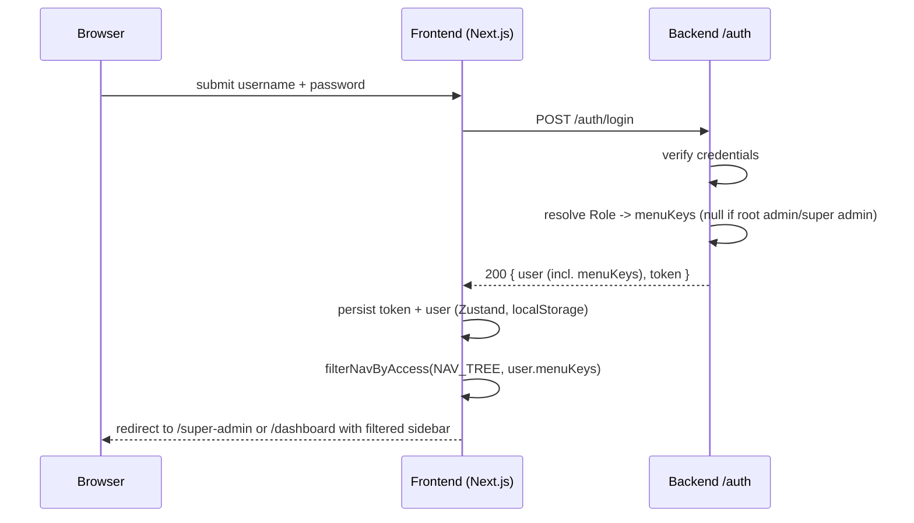
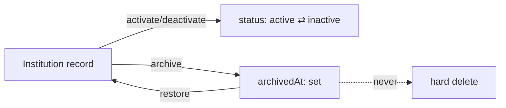
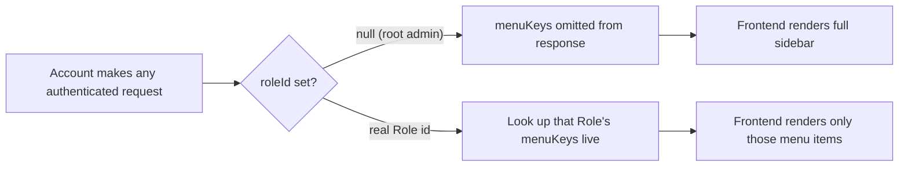
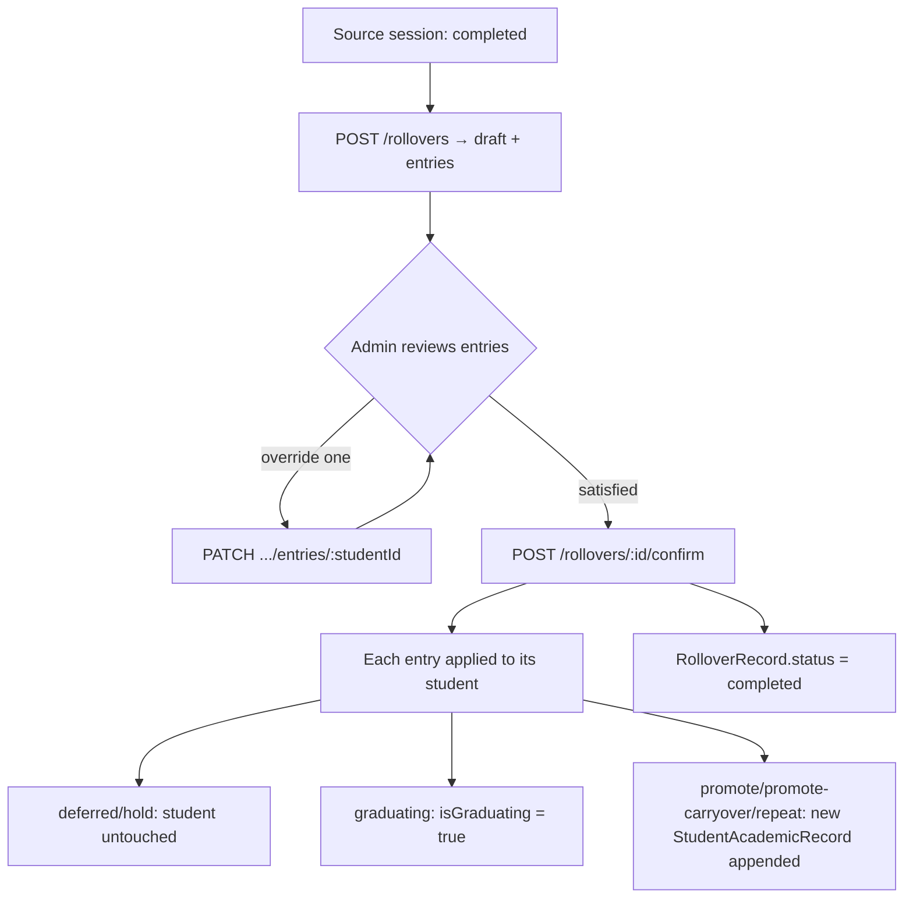
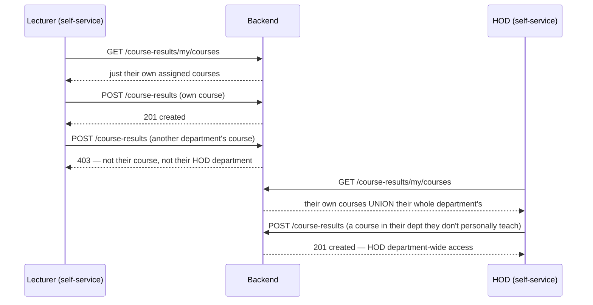
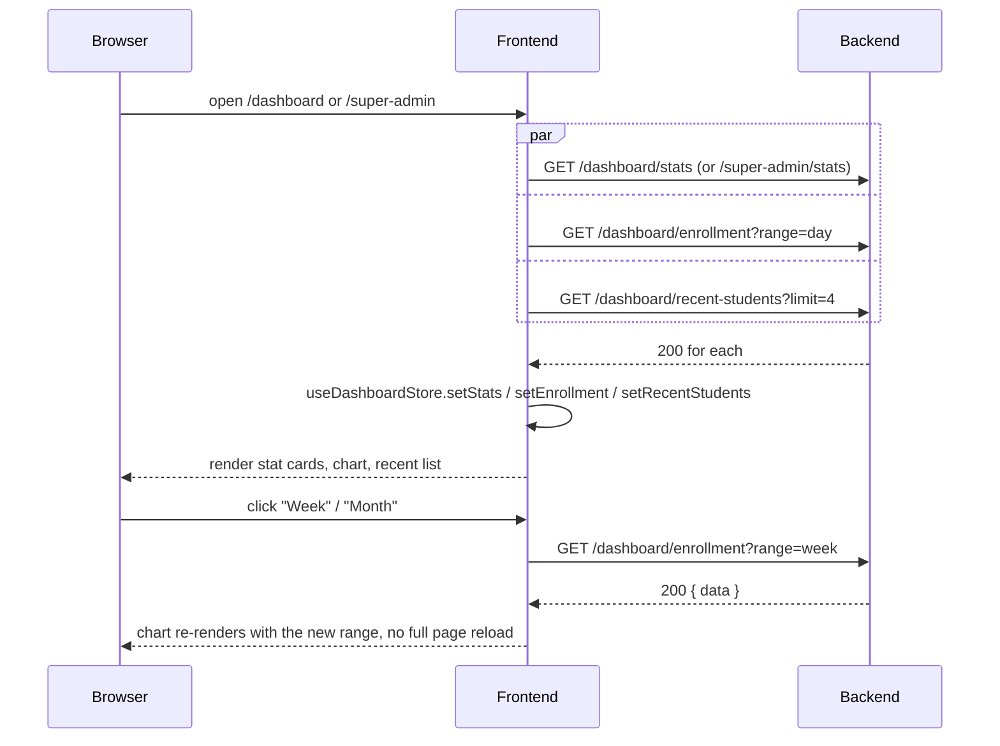
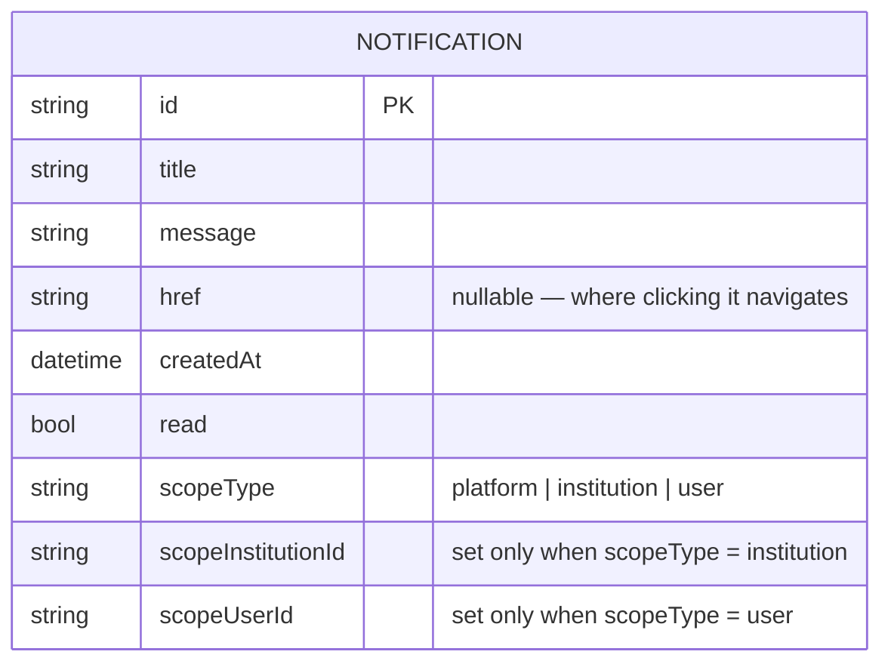
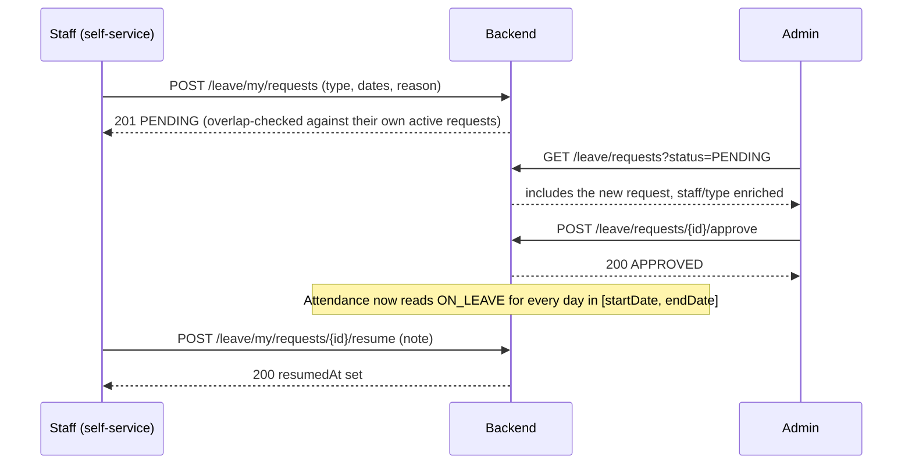
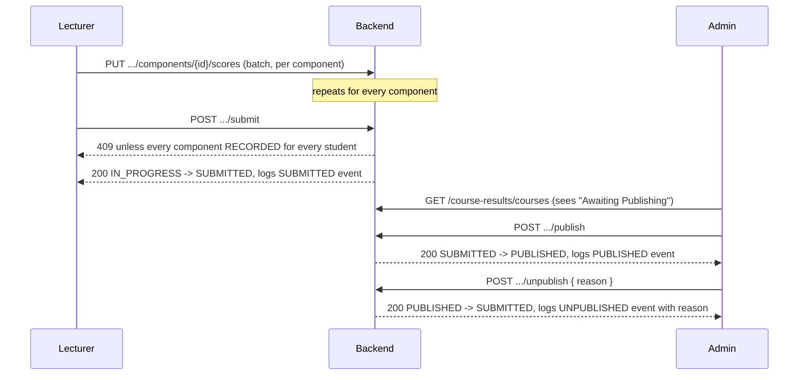

# T-Educare — API Contract

This is the spec the backend must implement so the existing frontend (already
built against a mocked version of this contract — see
[frontend/CLAUDE.md](../frontend/CLAUDE.md#no-backend-yet)) works unchanged
once wired to a real API. It supersedes the short version in
[README.md](./README.md).

Frontend reference points, if anything here is ambiguous:

- `frontend/src/services/auth.service.ts` — current mocked `authService`
- `frontend/src/store/rbac.store.ts` — Role/ManagedUser shape + seed data
- `frontend/src/store/institutions.store.ts` — Institution shape + seed data
- `frontend/src/store/academics.store.ts`, `src/store/staff.store.ts` — the
  two other mocked domains already wired to real pages
- `frontend/src/config/nav.ts` — the full, authoritative list of menu **keys**
  (`INSTITUTION_NAV`, `SUPER_ADMIN_NAV`) referenced by `Role.menuKeys` below

This document only covers what the frontend currently calls. More resources
(Registration, full Academics CRUD, Financials, Results, Hostel, Transport,
Announcements, Requests, Support, etc.) exist today only as nav entries
pointing at placeholder pages — their contracts will follow the same
conventions below and get added here as each one is built.

## Status

**Auth (§3), Profile (§3.1), file uploads (§3.2), Dashboards (§9),
Institutions §4.1/4.3/4.4, User Manager (§4.5), Modules (§4.6), License
Manager (§4.7), and Roles (§5, folded into §4.5 rather than a separate
§6 — see its own note) are all implemented, live, and wired to the
frontend** — see `backend/README.md`'s "What's implemented" section for
exactly what that covers (real MSSQL-backed tables via Flyway, not
in-memory; real Cloudinary uploads, not local-only previews;
`institutions.store.ts`/`user-managers.store.ts` no longer seed mock
data). File uploads (§3.2) are wired for institution logos, User Manager
avatars, and profile avatars. **Every field on every resource above is
real and server-backed** — as of §4.7 (2026-09-26) there is no longer any
"local-only, resets on reload" screen left for these resources.
**Notifications (§10) are also real now (2026-09-26)** — every action on
Institutions/User Manager/Modules/License Manager creates one server-side,
at the same point that action's success response is returned; the
frontend bell/full-page feed reads the real `GET /notifications` endpoint
directly, no client-side merge with anything local anymore (that merge
was removed the same day, for both roles — see `frontend/CLAUDE.md`).
Academic Sessions & Semesters (§7/§7.1) are also real now (2026-09-27).
Schools (§7.4) are also real now and wired to the frontend (2026-09-28) —
`schools.store.ts` is hydration-only, no more seed data. Faculties (§7.5)
are also real now and wired to the frontend (2026-09-29) —
`faculties.store.ts` is hydration-only too. Departments (§7.6) are also
real now and wired to the frontend (2026-10-02) —
`departments.store.ts` is hydration-only too. Programs (§7.7) are also
real now and wired to the frontend (2026-10-02) — `programs.store.ts`
is hydration-only too. Program Levels (§7.8) are also real now and
wired to the frontend (2026-10-06) — `program-levels.store.ts` is
hydration-only too. Course Grades (§7.9) are also real now and wired
to the frontend (2026-10-07) — `course-grades.store.ts` is
hydration-only too. Courses (§7.10) are also real now (2026-10-07),
wired to the frontend the same week (2026-10-07) — `courses.store.ts`
is hydration-only too — this closes out the entire Academics submenu,
both backend and frontend (Sessions through Courses are all real end to
end).
License status — grace period, suspension, and the audit log (§4.8) is
also real now (2026-10-08) and wired to `/super-admin/license-manager`
the same day.
Everything else below (Students, Session Rollover, Staff) is
**not implemented yet** — this file remains what to build those
*against*.

## Deployment

The frontend is deployed and live at **https://t-educare.vercel.app/**
(Vercel), in addition to local dev at `http://localhost:3000`. Both origins
need to work against this API once it exists:

- **CORS**: allow both `http://localhost:3000` and
  `https://t-educare.vercel.app` as origins (`Access-Control-Allow-Origin`),
  with credentials enabled if the auth scheme ends up needing cookies rather
  than the bearer-token approach described below. Don't hardcode just one —
  local dev and the deployed preview both need to reach the API throughout
  development.
- Vercel also generates a preview-deployment URL per branch/PR
  (`https://t-educare-<hash>-<team>.vercel.app` or similar) — if the backend
  needs to support those too, allow-list by suffix/pattern rather than a
  fixed list of exact origins, since each preview gets a new one.
- The frontend currently has no backend to call yet (see Status above), so
  none of this is exercised until `NEXT_PUBLIC_API_URL` is set on both the
  local `.env` and the Vercel project's environment variables to point at
  wherever this API ends up deployed.

---

## 1. Conventions

- **Base URL**: `NEXT_PUBLIC_API_URL` (frontend `.env`), all paths below are
  relative to it.
- **CORS**: allow `http://localhost:3000` (local dev) and
  `https://t-educare.vercel.app` (deployed frontend) — see Deployment above.
- **Auth**: `Authorization: Bearer <token>` on every request except
  `POST /auth/login`. An invalid/expired token → `401`, which the frontend's
  axios interceptor treats as a forced logout.
- **Content type**: `application/json` both ways.
- **IDs**: opaque strings (UUID/cuid — anything stable and non-guessable).
- **Timestamps**: ISO 8601 UTC strings, e.g. `"2026-03-10T14:32:00.000Z"`.
- **Errors**: any non-2xx returns

  ```json
  { "error": "Human-readable message safe to show the user" }
  ```

  (`frontend/src/lib/axios.ts` reads `error.response.data.error` directly
  into the toast shown to the user — keep it short and non-technical.)
- **Lists**: paginated resources return

  ```json
  { "data": [ /* items */ ], "meta": { "page": 1, "perPage": 20, "total": 57 } }
  ```

  Query with `?page=1&perPage=20`. Small, bounded lists (roles, sessions,
  designations — anything an institution manages by hand, not "every
  student") may skip pagination and just return `{ "data": [...] }`.
- **Multi-tenancy is server-enforced, not client-supplied.** Every
  institution-scoped resource (roles, users, sessions, semesters,
  designations, and everything that follows) is implicitly filtered by the
  authenticated user's own institution — derived from their token server-side.
  Never accept a client-supplied `institutionId` on these routes; a request
  from institution A must be structurally incapable of reading or writing
  institution B's data, regardless of what a client sends.
- **Every admin table follows the same Edit / [resource-specific action] /
  Delete pattern**, deliberately kept identical across resources —
  institutions (Edit / Activate-Deactivate / Delete), user managers (Edit /
  Reset password / Delete), license records (Edit / Regenerate key /
  Revoke), and any future admin list: a single actions menu per row, a
  confirmation prompt before every state-changing action, and "delete"
  meaning either archive (institutions, user managers — soft-delete,
  restorable, never a hard delete) or a reset-to-default (license records —
  see 4.7.2, since nothing is actually being deleted there). This is a
  frontend/UX convention, not a per-resource quirk, so treat any new
  admin-facing list the same way rather than inventing a new pattern.
- **Every select/dropdown in the frontend renders through one of two shared
  components** (`frontend/src/components/shared/notched-field.tsx`) rather
  than a bare `<select>`: `NotchedSelectField` for short, fixed option
  lists (gender, license type), `NotchedComboboxField` — a searchable
  combobox — for anything with "a lot of information" to scroll through
  (institutions, states/countries). A date field goes through
  `NotchedDateField` (a real calendar popup, not a native
  `<input type="date">`). This doesn't change anything about this API
  contract, but if you're the one eventually building the admin UI against
  it, don't reintroduce native form controls for these — reuse the shared
  components so every dropdown/date-picker in the app stays visually and
  behaviorally consistent.

---

## 2. Data model

```mermaid
erDiagram
    INSTITUTION ||--o{ ROLE : "defines"
    INSTITUTION ||--o{ USER : "employs"
    INSTITUTION ||--o{ ACADEMIC_SESSION : "runs"
    INSTITUTION ||--o{ STAFF_DESIGNATION : "defines"
    INSTITUTION ||--o{ STAFF_MEMBER : "employs"
    DEPARTMENT ||--o{ STAFF_MEMBER : "assigned to"
    INSTITUTION ||--o{ LECTURER : "employs"
    SCHOOL ||--o{ LECTURER : "assigned to when assignmentType=school, see 8.2"
    FACULTY ||--o{ LECTURER : "assigned to when assignmentType=faculty, see 8.2"
    INSTITUTION ||--o{ USER_MANAGER_ACCOUNT : "assigned"
    ACADEMIC_SESSION ||--o{ ACADEMIC_SEMESTER : "contains"
    ROLE ||--o{ USER : "assigned to"
    INSTITUTION ||--o{ STUDENT : "enrolls"
    ACADEMIC_SESSION ||--o{ STUDENT : "currently enrolled under"
    INSTITUTION ||--o{ SCHOOL : "defines"
    SCHOOL ||--o{ STUDENT : "enrolled under"
    SCHOOL ||--o{ FACULTY : "contains"
    FACULTY ||--o{ DEPARTMENT : "contains"
    SCHOOL ||--o{ DEPARTMENT : "independently linked to, see 7.6"
    DEPARTMENT ||--o{ PROGRAM : "offers"
    FACULTY ||--o{ PROGRAM : "independently linked to, see 7.7"
    INSTITUTION ||--o{ PROGRAM_LEVEL : "defines"
    INSTITUTION ||--o{ COURSE_GRADE : "defines"
    INSTITUTION ||--|| GRADING_SCALE : "configures"
    DEPARTMENT ||--o{ COURSE : "offers"
    SCHOOL ||--o{ COURSE : "independently linked to, see 7.10"
    INSTITUTION ||--o{ ROLLOVER_RECORD : "runs"
    ACADEMIC_SESSION ||--o{ ROLLOVER_RECORD : "rolled over from/to"

    INSTITUTION {
        string id PK
        string code "display-only sequential code, e.g. 001 — not the PK"
        string name
        string institutionType "University | Polytechnic | College | Secondary School | Primary School"
        string address
        string city
        string countryState "e.g. Nigeria - Ogun State"
        string principalName
        string principalEmail
        string principalPhone
        string adminUser "primary admin's name — this is who the institution's root login belongs to"
        string adminEmail
        string logoUrl "nullable"
        string[] moduleKeys "keys from GET /modules — see 4.6"
        datetime modulesLastEditedAt "nullable — null until first linked, see 4.6"
        int modulesCount "always derived: moduleKeys.length — 0 for an unlinked institution, never a separate stored number"
        int studentCount
        int revenue
        string licenseType "Basic | Standard | Premium"
        datetime expiringAt "nullable — null only for Basic (the free tier); Standard/Premium always have one, see 4.7"
        string tokenKey "institution's general API/access token — distinct from licenseKey, see 4.7"
        string licenseKey "nullable — this institution's license record's own key, set via /super-admin/license-manager, see 4.7"
        datetime licenseIssuedAt "nullable — immutable once set, the license record's original creation date, see 4.7"
        string status "active | inactive — toggled by activate/deactivate, never by archiving"
        datetime createdAt
        datetime archivedAt "nullable — soft-delete, see 4.4"
    }
    ROLE {
        string id PK
        string institutionId FK
        string name
        string description
        string[] menuKeys "keys from frontend/src/config/nav.ts"
        bool isSystem "true = root admin role, uneditable"
        datetime createdAt
    }
    USER {
        string id PK
        string institutionId FK "null for super_admin"
        string roleId FK "null for super_admin"
        string firstName
        string lastName
        string email
        string role "super_admin | institution_admin"
        string status "active | suspended"
        datetime createdAt
    }
    ACADEMIC_SESSION {
        string id PK
        string institutionId FK
        string session "e.g. 2024/2025"
        date from
        date to
        string status "upcoming | active | completed"
        bool isCurrent "at most one session per institution — see 7.1"
        datetime archivedAt "nullable — soft-delete"
    }
    ACADEMIC_SEMESTER {
        string id PK
        string sessionId FK
        string name
        string description
        date from
        date to
        string status "upcoming | active | completed"
        bool isCurrent "at most one semester per session — see 7.1"
        datetime archivedAt "nullable — soft-delete"
    }
    STUDENT {
        string id PK
        string institutionId FK
        string matricNo "display code, e.g. UL-10044 — unique among non-archived students"
        string title "Mr | Mrs | Miss | Dr | Chief | Engr | Prof"
        string firstName
        string middleName "nullable"
        string lastName
        string otherName "nullable — a distinct alternate/preferred name, not the same as middleName"
        string gender "Male | Female | Other"
        string maritalStatus "Single | Married | Divorced | Widowed"
        string email
        string phone
        string emergencyContact
        datetime dateOfBirth
        string religion "Christian | Islam | Traditional | Other"
        string maidenName "nullable"
        string bloodGroup "A+ | A- | B+ | B- | AB+ | AB- | O+ | O-"
        string genotype "AA | AS | SS | AC"
        int weightKg
        int heightCm
        string nationality
        string stateOfOrigin
        string lga
        string residentAddress
        string avatarUrl "nullable"
        string schoolId FK "SCHOOL.id"
        string faculty
        string department
        string programme
        string currentLevel "e.g. 100 Level"
        string currentSessionId FK "ACADEMIC_SESSION.id — the session this student is currently enrolled under"
        string status "active | inactive — admin-facing enrollment status, distinct from the flags below"
        bool isGraduating
        bool isDeferred
        bool holdForReview
        datetime createdAt
        datetime archivedAt "nullable — soft-delete"
    }
    SCHOOL {
        string id PK
        string institutionId FK
        string name "e.g. School of Engineering"
        string headName
        string designation "validated against STAFF_DESIGNATION.name — see 7.4/8"
        datetime createdAt
        datetime archivedAt "nullable — soft-delete"
    }
    FACULTY {
        string id PK
        string institutionId FK
        string schoolId FK "SCHOOL.id"
        string name "e.g. Faculty of Law"
        string deanName
        datetime createdAt
        datetime archivedAt "nullable — soft-delete"
    }
    DEPARTMENT {
        string id PK
        string institutionId FK
        string facultyId FK "FACULTY.id"
        string schoolId FK "SCHOOL.id — independent of facultyId, see 7.6"
        string name "e.g. Mathematics Department"
        string hodName
        datetime createdAt
        datetime archivedAt "nullable — soft-delete"
    }
    PROGRAM {
        string id PK
        string institutionId FK
        string departmentId FK "DEPARTMENT.id"
        string facultyId FK "FACULTY.id — independent of departmentId, see 7.7"
        string name "e.g. Computing and IT"
        string programType "Undergraduate | Postgraduate"
        datetime createdAt
        datetime archivedAt "nullable — soft-delete"
    }
    PROGRAM_LEVEL {
        string id PK
        string institutionId FK
        string levelCode "e.g. 100 — independent lookup, not related to STUDENT.currentLevel, see 7.8"
        string description "e.g. 100 levels"
        datetime createdAt
        datetime archivedAt "nullable — soft-delete"
    }
    COURSE_GRADE {
        string id PK
        string institutionId FK
        string code "e.g. A, AB"
        string remark "e.g. Distinction"
        float gradeScore
        float minimumScore
        float maximumScore
        datetime createdAt
        datetime archivedAt "nullable — soft-delete"
    }
    GRADING_SCALE {
        string institutionId PK "one row per institution, not a normal CRUD resource — see 7.9"
        float maxGradePoint
    }
    COURSE {
        string id PK
        string institutionId FK
        string departmentId FK "DEPARTMENT.id"
        string schoolId FK "SCHOOL.id — independent of departmentId, see 7.10"
        string name "e.g. Pure Mathematics"
        string code "e.g. MAT101 — unique among non-archived courses"
        datetime createdAt
        datetime archivedAt "nullable — soft-delete"
    }
    ROLLOVER_RECORD {
        string id PK
        string institutionId FK
        string fromSessionId FK
        string toSessionId FK
        datetime createdAt
        datetime completedAt "nullable — null while status is draft"
        string status "draft | completed"
    }
    STAFF_DESIGNATION {
        string id PK
        string institutionId FK
        string name
        string description
        string category "Academic Staff | Non-Academic Staff"
        datetime createdAt
        datetime archivedAt "nullable — soft-delete"
    }
    STAFF_MEMBER {
        string id PK
        string institutionId FK
        string staffId "display code, e.g. UL-10010 — unique among non-archived staff"
        string role "validated against STAFF_DESIGNATION.name, see 8.1"
        string designation "validated against STAFF_DESIGNATION.name — a separate field from role, see 8.1"
        string departmentId FK "DEPARTMENT.id"
        string gender "Male | Female | Other"
        string firstName
        string middleName "nullable"
        string lastName
        string otherName "nullable"
        string maritalStatus "Single | Married | Divorced | Widowed"
        string email
        string phone
        string emergencyContact
        datetime dateOfBirth
        datetime employmentStartDate
        string contactAddress
        string avatarUrl "nullable"
        datetime createdAt
        datetime archivedAt "nullable — soft-delete"
    }
    LECTURER {
        string id PK
        string institutionId FK
        string username "display code, e.g. UL-10010 — unique among non-archived lecturers"
        string position "Dean of a Faculty | Head of Department | Provost | Professor | Associate Professor | Senior Lecturer | Lecturer I | Lecturer II | Assistant Lecturer — see 8.2"
        string assignmentType "school | faculty"
        string assignmentId "polymorphic FK — SCHOOL.id when assignmentType=school, FACULTY.id when assignmentType=faculty, see 8.2"
        string gender "Male | Female | Other"
        string firstName
        string middleName "nullable"
        string lastName
        string otherName "nullable"
        string email
        string phone
        datetime createdAt
        datetime archivedAt "nullable — soft-delete"
    }
    USER_MANAGER_ACCOUNT {
        string id PK
        string code "display-only sequential code, e.g. 001 — not the PK"
        string institutionId FK "the institution this admin account is assigned to"
        string firstName
        string otherName "nullable"
        string lastName
        string gender "Male | Female | Other"
        string email
        string phone
        string username "unique"
        string passwordHash
        bool isPrimaryAdmin "true = this institution's root login (see USER.adminUser)"
        string avatarUrl "nullable"
        string status "active | inactive"
        datetime createdAt
        datetime archivedAt "nullable — soft-delete, see 4.5.5"
    }
```



---

## 3. Auth

### `POST /auth/login`

```json
// Request
{ "username": "Turon_Admin", "password": "Turon@2024" }
```

```json
// Response 200
{
  "user": {
    "id": "usr_123",
    "firstName": "Christian",
    "lastName": "Smart",
    "email": "christian.smart@turontech.com",
    "role": "institution_admin",
    "institutionId": "inst_xyz",
    "institutionName": "XYZ College of Technology",
    "roleId": "role_abc",
    "menuKeys": null,
    "phone": "08022223333",
    "avatarUrl": ""
  },
  "token": "opaque-bearer-token"
}
```

**Implemented** (`backend/src/main/java/com/teducare/auth/`), backed by a
real `dbo.users` table in MSSQL (Flyway-managed, see
`db/migration/V1__init_schema.sql`), seeded with 3 BCrypt-hashed demo
accounts on first boot if the table is empty (`DemoAccountSeeder.java`) —
`super_admin`, `turon_admin` (XYZ College, unrestricted), `amara_bello`
(Ahmadu Bello University, restricted "Front Desk Officer" role). JWT
claims carry `role`/`userId`; `GET /auth/me` and `POST /auth/logout` (204,
clears the security context server-side) both work as documented above.

- **An `institution_admin` login authenticates against `UserManagerAccount`
  records (4.5), not a separate identity.** The username/password an
  institution admin logs in with are exactly the credentials shown (and
  editable — see 4.5.3's reset-password) on the super admin's User Manager
  screen. There is no separate "staff directory" of login identities:
  `USER_MANAGER_ACCOUNT.institutionId` decides *which* institution this
  login lands in, and a deactivated (`status: "inactive"`) or archived
  account must be rejected at login even with a correct password. A Role
  (5) is then resolved separately, by whatever mechanism links a Role to a
  person within that institution (today's mock keys this off matching
  email between `UserManagerAccount` and the institution's own staff
  directory — a real implementation should use a proper FK instead, but the
  two-step "which account, then which Role" shape should stay the same).
- `role` is `"super_admin"` or `"institution_admin"`.
- `menuKeys` is the **resolved** permission set for this login, so the
  frontend can render the sidebar without a second round trip:
  - `null` → unrestricted (root admin of the institution, or super admin).
  - `string[]` → exactly the keys from `frontend/src/config/nav.ts` this user
    may see, resolved server-side from their `Role.menuKeys` at login time.
  - **Resolution must apply two layers, not one**: a nav key only belongs in
    the resolved set if (a) the user's Role grants it (or the Role is
    unrestricted) **and** (b) it isn't gated behind a `moduleKey` the
    institution hasn't activated (see 4.6.3) — an unrestricted root admin is
    still capped by their institution's `moduleKeys`, only a restricted Role
    is capped further on top of that. Today's mocked frontend computes this
    same two-layer intersection client-side
    (`filterNavByModules` then `filterNavByAccess` in
    `frontend/src/config/nav.ts`) since it has no login endpoint yet — once
    this exists, move that resolution here and simplify the frontend to just
    render whatever `menuKeys` it's given.
- Wrong credentials → `401 { "error": "Invalid username or password." }`
  (exact copy the frontend already shows for its mocked version — keep it,
  or update `frontend/src/services/auth.service.ts` to match a new one).
- **A deactivated institution's accounts cannot log in**, even with correct
  credentials → `401 { "error": "Your institution's access has been
  deactivated. Contact the platform administrator." }`. Checked at login
  time against the institution's real `status` (§4.3) — enforced in
  `CustomAuthenticationProvider`, right after the password check. This only
  blocks *new* logins; an already-issued JWT from before deactivation stays
  valid until it expires (no server-side session/token store exists to
  revoke it early — see §9's dashboard-numbers note for the same
  "in-memory demo, not yet a full session store" caveat).
- `institutionName`/`institutionLogoUrl` are resolved **live** from the
  real Institution record (§4) at login time, not a stale snapshot —
  renaming an institution or setting its logo on `/super-admin/institutions`
  shows up on that institution's accounts' *next* login automatically.
  `institutionLogoUrl` is `""` until a logo is set (Jackson's `non_null`
  inclusion would otherwise omit the field entirely — normalized to `""`
  server-side the same way `phone`/`avatarUrl` already are).

### `GET /auth/me`

Returns the same `user` shape as login, for session restore. Requires a
valid bearer token.

### `POST /auth/logout`

Invalidates the token server-side if your auth scheme supports that (e.g.
a session/refresh-token store). `204` on success. The frontend already
clears its own local state regardless of this call's outcome.



### 3.1 Profile — the logged-in user's own account

**Implemented** (`backend/src/main/java/com/teducare/profile/`). Scoped to
whoever the bearer token belongs to — there's no `:id` in any of these
routes, unlike every admin-facing resource elsewhere in this contract.

| Method | Path              | Body                                                        | Notes |
|--------|-------------------|---------------------------------------------------------------|-------|
| GET    | `/profile`       | —                                                                | returns `{ profile, summary }` — see below |
| PATCH  | `/profile`       | any subset of `{ firstName, lastName, email, phone, avatarUrl }` | partial update — a field left out (or `null`) keeps its current value; a blank string is also treated as "no change" for `firstName`/`lastName`/`email` (there's no way to blank those out) |
| PATCH  | `/profile/password` | `{ currentPassword, newPassword }`                            | `400` if `currentPassword` doesn't match, or `newPassword` is under 8 characters |

```json
// GET /profile response 200 (super_admin)
{
  "profile": {
    "id": "demo-super-admin",
    "firstName": "Adetunji",
    "lastName": "Aderinwale",
    "email": "ade.adetunji@turontech.com",
    "role": "super_admin",
    "institutionId": null,
    "institutionName": null,
    "roleId": null,
    "phone": "08012345678",
    "avatarUrl": "",
    "menuKeys": []
  },
  "summary": {
    "institutionsCount": 6,
    "licensed": 1,
    "linkedModules": 3,
    "userManagerAccounts": 7
  }
}
```

`summary` shape depends on `role`: a `super_admin` gets the platform-wide
counters above; an `institution_admin` instead gets
`{ institutionName, roleId, menuKeysCount, institutionStatus }`. **Real
since 2026-09-26** — `institutionsCount` reads the exact same
`InstitutionRepository.countActive()` query `GET /super-admin/stats` (§9.4)
uses, so the two are now guaranteed to agree by construction rather than
being two independently-hardcoded literals that merely happened to match.
`licensed`/`linkedModules` count non-archived institutions with a real
license/at least one linked module respectively; `userManagerAccounts`
counts non-archived `institution_admin` rows.

`institution_admin`'s `institutionStatus` (added 2026-09-26, same real-
data pass as the notifications cleanup below) is a live
`InstitutionRepository.findById(institutionId)` lookup, not a hardcoded
`"active"` literal — the frontend's `/dashboard/profile` "My Institution"
card used to show a literal `"Active"` regardless of the real row.
`menuKeysCount` (`0` for both "genuinely unrestricted" and the degenerate
"restricted to nothing" case — the frontend treats both as "Full access",
matching how nav filtering already treats a null `menuKeys`) already
existed but wasn't rendered anywhere on the frontend before this pass.

`PATCH /profile/password` never returns the new password (unlike the super
admin's `POST /user-managers/:id/reset-password`, §4.5.4, which is a
different action performed *on someone else's* account) — the caller
already knows it, since they just typed it.

### 3.2 File uploads

**Implemented** (`backend/src/main/java/com/teducare/upload/UploadController.java`):

```
POST /uploads   multipart/form-data, field name "file"   → 200, { "url": "..." }
```

Any authenticated user may call this — it's not super-admin-gated like
Institutions (§4). Server-side signed upload to Cloudinary (same account as
the sibling `t-coop-backend` project, `config/CloudinaryConfig.java`), PNG/
JPEG/WEBP only, 5MB max, stored under the `t-educare/uploads` folder.
Verified live: a real upload returns a genuine
`https://res.cloudinary.com/...` URL.

**Real bug fixed (2026-09-26): any file over 1MB failed with a silent
500.** Spring Boot's own default multipart limit
(`spring.servlet.multipart.max-file-size`) is **1MB**, well below this
controller's documented 5MB business limit — a real photo between 1MB
and 5MB never even reached the controller's own size check; Spring
rejected it first with `MaxUploadSizeExceededException`, which fell
through to the generic exception handler and returned
`{"error":"Something went wrong."}` with **no server-side log entry at
all** (see `common/GlobalExceptionHandler.java` — reported by a real user
trying to change an institution admin's profile picture). Fixed by
raising `application.yml`'s `spring.servlet.multipart.max-file-size`/
`max-request-size` to 10MB (a technical ceiling above the controller's
real 5MB rule, not a new business limit) and adding a dedicated
`@ExceptionHandler(MaxUploadSizeExceededException.class)` returning a
clean `400 {"error":"File is too large."}` for anything past that.
`GlobalExceptionHandler`'s catch-all now also logs every unhandled
exception server-side (`log.error("Unhandled exception", ex)`) — it
previously swallowed the real cause of *every* 500 in the app, not just
this one, making any future 500 equally undebuggable from the logs alone.
Verified live: a real 1.4MB PNG now uploads successfully (200, genuine
`res.cloudinary.com` URL); a 12MB file now gets a clean 400 instead of
hanging or 500ing.

**Wired to the frontend for institution logos (2026-09-24)** —
`institution-dialog.tsx` calls `POST /uploads` on file select and sends the
returned Cloudinary `url` as `logoUrl`, not a data URL (the `logo_url`
column is `NVARCHAR(500)`; a data URL would blow past that). **Profile
avatars are not wired yet** — `ProfileHeroCard` still reads a picked file
into a `data:` URL client-side (`readFileAsDataUrl()`) and sends that
directly as `avatarUrl` on `PATCH /profile` (§3.1). Same fix when that
happens: call `POST /uploads` first, send the returned `url` instead of the
data URL — both call sites can share the same `useUploadFile()` hook
(`frontend/src/hooks/use-upload.ts`), already used by the institution
dialog.

---

## 4. Institutions — super admin only

All routes below require `role: "super_admin"` → otherwise `403`.

**4.1, 4.3, and 4.4 are implemented** (`backend/src/main/java/com/teducare/institution/`),
backed by a real `dbo.institutions` table (Flyway, `V2__institutions.sql`),
seeded with 5 demo institutions on first boot (`DemoInstitutionSeeder.java`) —
two of which (`inst-xyz-college`, `inst-ahmadubellouniversit-1`) reuse the
exact ids the `turon_admin`/`amara_bello` login accounts already reference
as their `institutionId`, so both stay consistent. The `role: "super_admin"`
check above is enforced manually in `InstitutionController` (there's no
Spring `hasRole`/authorities set up yet — see `JwtAuthenticationFilter`,
which grants an empty authority list — so this resolves the caller's real
role the same way `ProfileController`/`DashboardController` already do, via
`AuthDirectory`; the same small guard method is the pattern to reuse for
4.5/4.6/4.7 once those get built). **4.2 is folded into 4.1's `POST`** (same
endpoint, this subsection just documents its request shape) — implemented
alongside it. **4.5 (User Manager), 4.6 (Modules), and 4.7 (License
Manager) are not implemented yet** — those are separate super-admin pages
(`/super-admin/user-manager`, `/super-admin/modules`,
`/super-admin/license-manager`), not part of this pass. **Wired to the
frontend (2026-09-24)** — `institutions.store.ts` no longer seeds mock
data; it's hydrated from these real endpoints (see `frontend/CLAUDE.md`
for the full architecture, including how Modules/License Manager's own
still-unbuilt actions stay local-only on top of this real data without
pretending to persist).

### 4.1 List / create / edit

| Method | Path                    | Body                                          | Notes |
|--------|-------------------------|------------------------------------------------|-------|
| GET    | `/institutions`         | —                                              | list, supports pagination + `?search=` (matches name or adminUser) + `?includeArchived=true` (default `false` — see 4.4) |
| POST   | `/institutions`         | see 4.2                                        | `modulesCount`/`studentCount`/`revenue` default `0`, `licenseType` defaults `"Basic"`, `expiringAt`/`licenseKey`/`licenseIssuedAt` default `null`, `status` defaults `"active"` |
| PATCH  | `/institutions/:id`     | any subset of `Institution` fields             | for editing; also accepts `{ status }` alone but prefer 4.3 for that so the intent (and audit trail) is explicit |

`Institution` response shape — see the ER diagram above.

### 4.2 Creating an institution — form fields

The "Add New Institution" form collects everything **except** `modulesCount`
and `licenseType` — those are configured afterwards via the Modules (4.6)
and License Manager (4.7) screens, so a freshly created institution always
starts unlinked/unlicensed: `modulesCount: 0`, `licenseType: "Basic"`,
`expiringAt`/`licenseKey`/`licenseIssuedAt`: `null`.

```json
// POST /institutions request body
{
  "name": "Covenant University",
  "institutionType": "University",
  "address": "KM 10 Idiroko Road",
  "city": "Ota",
  "countryState": "Nigeria - Ogun State",
  "principalName": "Prof. David Oyedepo",
  "principalEmail": "principal@covenantuniversity.edu.ng",
  "principalPhone": "08011112222",
  "adminUser": "Ngozi Eze",
  "adminEmail": "admin@covenantuniversity.edu.ng",
  "logoUrl": "https://cdn.example.com/logos/covenant.png"
}
```

`logoUrl` — the frontend currently only previews the picked file locally
(via `URL.createObjectURL`, never uploaded anywhere). `POST /uploads`
(§3.2) is that upload endpoint now, already implemented and generic (not
institution-specific) — the frontend calls it first, then sends the
resulting `url` as `logoUrl` in this request. Not wired up yet, same as
avatars (§3.2's note).

`code` and `tokenKey` are server-generated — never accept them from the
client. `id` and `createdAt` are standard server-generated fields.

### 4.3 Activate / deactivate

```
PATCH /institutions/:id/status
{ "status": "active" }   // or "inactive"
```

The frontend always confirms this with the user first ("Are you sure you
want to activate/deactivate X?") before calling it — that's a client-side
UX guard, not something the backend needs to enforce, but do treat this as
a meaningful state transition worth its own audit log entry (an institution
losing access is a significant event for whoever their `adminUser` is).

### 4.4 Archive / restore — soft delete only

**There is no hard-delete endpoint for institutions.** The frontend's
"delete" action archives instead — it sets `archivedAt` and hides the record
from the default list view; nothing is ever destroyed.

```
POST /institutions/:id/archive   → 200, sets archivedAt = now
POST /institutions/:id/restore   → 200, sets archivedAt = null
```

`GET /institutions` excludes archived records unless `?includeArchived=true`
is passed (that's what the frontend's "View archived" toggle calls). An
archived institution keeps its `status` field as-is (archiving is
orthogonal to active/inactive) — restoring one doesn't change `status`
either, it comes back exactly as it was archived.



### 4.5 User Manager — super admin only

Platform-level admin accounts, each assigned to one institution (the "User
Manager" screen at `/super-admin/user-manager`). This is distinct from
section 6 (`USER`/roles) — that's institution-scoped staff managed by an
*institution admin*; this is the super admin provisioning the institution's
own admin accounts.

**Implemented (2026-09-24)**, backend-only for now (not wired to the
frontend yet — `user-managers.store.ts` still mocks it). Architecturally,
this does **not** introduce a separate `UserManagerAccount` table — per
§3's own note above ("An institution_admin login authenticates against
UserManagerAccount records, not a separate identity"), a User Manager
account genuinely *is* the login identity, so it lives in the same
`dbo.users` table `auth/UserAccount.java` already maps, filtered to
`role = 'institution_admin'`. Creating one via `POST /user-managers`
creates a real row that can log in immediately through the existing
`POST /auth/login` (§3) — verified live. `V4__user_manager_fields.sql`
added `code`/`other_name`/`gender`/`is_primary_admin`/`archived_at` to
`dbo.users` (`status` already existed from `V1` but had never been mapped
or used by any code until this); `V5` backfilled the 3 pre-existing demo
accounts to the same shape, since `DemoAccountSeeder` only seeds on a
genuinely empty table and these rows had existed since long before V4 —
its current code updating them correctly never actually ran against them
until this explicit backfill. **A deactivated or archived User Manager
account is rejected at login** (`CustomAuthenticationProvider`, checked
right after the password check, same pattern and specific rejection
message style as institution deactivation in §3 — `401 { "error": "Your
account has been deactivated. Contact the platform administrator." }`).
Role-gated the same way Institutions is
(`UserManagerController`'s own `requireSuperAdmin` guard via
`AuthDirectory` — no Spring authorities exist yet).

#### 4.5.1 List / create / edit

| Method | Path                     | Body                                          | Notes |
|--------|--------------------------|------------------------------------------------|-------|
| GET    | `/user-managers`         | —                                              | list, supports pagination + `?search=` (matches username, email, or institution name) + `?includeArchived=true` (default `false` — see 4.5.5) |
| POST   | `/user-managers`         | see 4.5.2                                      | `status` defaults `"active"` |
| PATCH  | `/user-managers/:id`     | any subset of `UserManagerAccount` fields, plus `roleId` | for editing; `roleId` left out keeps the current assignment, `""` clears to unrestricted, any other value must be a real, same-institution, non-archived `Role.id` (§5) — `400` otherwise |

`UserManagerAccount` response shape — see the ER diagram above. Never
returns `passwordHash`.

#### 4.5.2 Creating an account — form fields

```json
// POST /user-managers request body
{
  "firstName": "Chris",
  "otherName": "Oluwakemi",
  "lastName": "Smart",
  "gender": "Male",
  "email": "chrissmart10@gmail.com",
  "phone": "08023778912",
  "username": "chrissmart10",
  "password": "a-plaintext-password-hashed-server-side",
  "institutionId": "inst-babcock",
  "isPrimaryAdmin": true,
  "avatarUrl": "https://cdn.example.com/avatars/chris.png"
}
```

The frontend's "Generate username" / "Generate password" buttons are purely
client-side conveniences (random suggestions the admin can edit before
submitting) — the server should still validate `username` uniqueness and
apply its own password policy, never trust the generated value's strength.

`avatarUrl` — same convention as institution `logoUrl` (4.2): frontend only
previews the picked file locally today; wire it to a real upload endpoint
when one exists.

`code` is server-generated — never accept it from the client. `id` and
`createdAt` are standard server-generated fields.

#### 4.5.3 Activate / deactivate

```
PATCH /user-managers/:id/status
{ "status": "active" }   // or "inactive"
```

Same convention as institutions (4.3): the frontend always confirms this
with the user first ("Are you sure you want to activate/deactivate X?"),
and it's worth its own audit log entry — a deactivated account should be
rejected at login even if its `passwordHash` still matches.

Both this and the institutions table drive their Edit / Activate-Deactivate
/ Delete actions from the same dropdown-menu pattern in the frontend (see
`src/components/ui/dropdown-menu.tsx`) — kept deliberately identical across
every admin table for consistency, not just this one.

#### 4.5.4 Reset password

```
POST /user-managers/:id/reset-password   → 200, { "password": "<new-plaintext-password>" }
```

The frontend always confirms this with the user first ("Are you sure you
want to reset the password for X?") before calling it. The server generates
a new password, hashes and stores it, and returns the plaintext exactly
once in the response so the admin can hand it to the account owner — it is
never retrievable again after that.

#### 4.5.5 Archive / restore — soft delete only

**There is no hard-delete endpoint for user manager accounts** — same
convention as institutions (4.4). The frontend's "delete" action archives
instead.

```
POST /user-managers/:id/archive   → 200, sets archivedAt = now
POST /user-managers/:id/restore   → 200, sets archivedAt = null
```

`GET /user-managers` excludes archived records unless
`?includeArchived=true` is passed. Archiving is orthogonal to `status`
(active/inactive) — restoring an account doesn't change `status`.

### 4.6 Modules — linking institutions to platform features

The "Modules" screen (`/super-admin/modules`) lets a super admin activate a
fixed catalog of platform features per institution. This extends the
`Institution` resource (4.1) rather than introducing a new one — see the two
new fields on `INSTITUTION` in the ER diagram above:

- `moduleKeys: string[]` — keys from the catalog below that are activated
  for this institution. Empty (`[]`) until the institution is first linked.
- `modulesLastEditedAt: datetime | null` — set whenever `moduleKeys` is
  saved; `null` if never linked.

#### 4.6.1 Module catalog

```
GET /modules   → 200, { "data": [ { "key": "registration", "label": "Registration" }, ... ] }
```

A small, fixed, server-owned list (not institution-specific) — a real
endpoint (`backend/module/ModuleCatalog.java`) rather than a frontend
constant, so the catalog can grow without a frontend redeploy. **Every
entry corresponds to exactly one real nav item in the institution_admin
dashboard, and every real nav item has exactly one entry here** (2026-09-26,
explicitly requested — the assignable list must match the institution
admin's own frontend one-to-one, not an aspirational broader catalog or a
partial mapping): Registration, Session Management, School Management,
Faculty Management, Department Management, Program Management, Program
Levels, Courses Grades, Courses Management, Student Management,
Designation, All Staff, User Management, Lecture Management, Financials,
Results Management, Hostel Management, Transport Management, Announcement,
Notifications, Requests, Support (22 entries). The only nav item
deliberately excluded is `dashboard` itself — always available once the
institution is reachable at all. Keep the same `key`s if the catalog
changes, since they're referenced by every institution's `moduleKeys`, and
keep `frontend/src/config/nav.ts`'s `moduleKey`s in sync in both
directions — a mismatch either orphans an assignable module with no nav
effect, or leaves a real page impossible to grant/revoke from this screen.

#### 4.6.2 List / link / edit

The Modules table only lists institutions with at least one activated
module — i.e. `GET /institutions` filtered client-side (today) by
`moduleKeys.length > 0`; no separate list endpoint is needed for the table
itself.

```
PATCH /institutions/:id/modules
{ "moduleKeys": ["payment", "students", "exams"] }
→ 200, sets moduleKeys, modulesCount = moduleKeys.length,
  modulesLastEditedAt = now, and status = "active"
```

That last side effect — activating an institution's status as part of
saving its modules — matches the frontend copy shown after picking an
institution in the "Link New Institution" dialog ("X is been selected and
made active"). The dialog only calls this endpoint once on Save; selecting
an institution and toggling checkboxes beforehand is local-only, so
cancelling the dialog persists nothing.

**The "Select an Institution" dropdown inside that dialog is a different
query from the table above — and it matters which one the backend serves:**

```
GET /institutions?unlinkedOnly=true
```

This must return **only** institutions with `moduleKeys.length === 0` (i.e.
never linked yet) — the same institutions that exist on the Institutions
page (4.1), just filtered to the ones nobody has assigned modules to. It
must never return an institution that already has `moduleKeys` set; editing
an already-linked institution's modules happens by clicking its name in the
Modules table instead (which opens the same dialog pre-filled via
`GET /institutions/:id`, not this endpoint). Getting this filter wrong
either lets a super admin silently overwrite an existing institution's
module set through the wrong entry point, or makes an unlinked institution
impossible to find once the list grows past a page or two.

#### 4.6.3 Effect on the institution's own dashboard

An institution's `moduleKeys` don't just drive this super-admin table —
they cap what that institution's *own* staff can ever be granted access to.
`frontend/src/config/nav.ts` maps a subset of `INSTITUTION_NAV` items to a
`moduleKey` (e.g. the `students` nav item requires the `students` module;
see the file for the full mapping — several nav items, like Dashboard,
Academic Sessions, and User Management, are intentionally ungated and
always available). Two places consume this:

- The institution dashboard's sidebar (`src/app/dashboard/layout.tsx`) —
  even the institution's unrestricted root admin only sees nav items backed
  by an activated module; "full access" means full access to what's been
  switched on for that institution, not the entire platform nav.
- The Role editor's menu-access picker
  (`src/components/features/user-management/role-dialog.tsx`) — an
  institution admin can only grant a custom Role access to menu items their
  own institution has been given, so a Role can never be built with reach
  beyond what the super admin allowed.

No new endpoint is needed for this — the frontend already has the calling
user's `institutionId` (from `POST /auth/login`, see 3) and that
institution's `moduleKeys` (from `GET /institutions/:id`, implicitly scoped
server-side to the caller's own institution per the multi-tenancy rule in
§1). Just make sure `moduleKeys` is included in whatever the institution
admin's own session/profile calls return — it's load-bearing for their nav,
not only for the super admin's Modules screen.

### 4.7 License Manager — issuing an institution's license record

Also extends `Institution` rather than introducing a new resource — see
`licenseType`, `expiringAt` (both already used by 4.1-4.3), plus the two
new fields in the ER diagram above: `licenseKey` and `licenseIssuedAt`.
`tokenKey` is a different field entirely (the institution's general API
token, set at creation in 4.2) — the License Manager screen shows it
read-only for reference but never edits it.

#### 4.7.1 List / create / edit

The License Manager table only lists institutions with a license record
already issued — i.e. `GET /institutions` filtered client-side (today) by
`licenseKey != null`; no separate list endpoint needed for the table
itself.

```
PATCH /institutions/:id/license
{
  "licenseType": "Premium",           // "Basic" | "Standard" | "Premium"
  "expiringAt": "2027-06-30T00:00:00.000Z",  // required unless licenseType is "Basic"
  "licenseKey": "BCO17-23671-23777-899C0"
}
→ 200, sets licenseType/expiringAt/licenseKey, and licenseIssuedAt = now
  only if this institution never had one before (immutable afterwards)
```

`licenseType: "Basic"` forces `expiringAt` to `null` server-side regardless
of what's sent — Basic is the free tier and never expires. Reject the
request (`422`) if a non-Basic type is submitted with no `expiringAt`.

Same "which institutions populate the create dropdown" concern as Modules
(4.6.2):

```
GET /institutions?unlicensedOnly=true
```

Must return only institutions with `licenseKey == null` — the ones with a
record already are edited by clicking their name in the table, which loads
via `GET /institutions/:id` instead, not this endpoint.

#### 4.7.2 Regenerate key / revoke license

```
POST /institutions/:id/regenerate-license-key   → 200, { "licenseKey": "<new key>" }
POST /institutions/:id/revoke-license            → 200, sets licenseType = "Basic",
                                                    licenseKey = null, expiringAt = null,
                                                    licenseIssuedAt = null
```

Both are confirmed with the user first on the frontend ("Are you sure you
want to regenerate/revoke..."), same convention as every other
activate/deactivate/delete action in this contract (§1). Revoking does
**not** archive or delete the institution — it only resets these license
fields back to their unlicensed defaults; the institution stays fully
intact and can get a new license record anytime via 4.7.1.

### 4.8 License status — grace period, suspension, and the audit log

**Implemented (2026-10-08)** — additive and separate from everything in
4.7 above. 4.7's `licenseType`/`licenseKey`/`expiringAt` describe *what*
license an institution holds; this section describes the institution's
current *standing* against payment/renewal obligations, independent of
that. It's also separate from the existing `status` field (4.3,
active/inactive) — that's the unrelated manual super-admin on/off switch
and is left completely untouched by everything below. A login is now
rejected if **either** `status == "inactive"` (existing check) **or**
`licenseStatus == "SUSPENDED"` (new check) — see
`CustomAuthenticationProvider`.

Two new fields on `Institution`:

```
licenseStatus: "ACTIVE" | "GRACE_PERIOD" | "SUSPENDED"   // default "ACTIVE"
graceEndsAt: ISO-8601 timestamp | null                    // set only while GRACE_PERIOD
```

```
POST /institutions/:id/start-grace-period
{ "reason": "Payment default.", "graceDays": 14 }         // graceDays optional, defaults to 14
→ 200, licenseStatus = "GRACE_PERIOD", graceEndsAt = now + graceDays
```

```
POST /institutions/:id/renew-license
{ "reason": "Payment received." }                          // reason optional
→ 200, licenseStatus = "ACTIVE", graceEndsAt = null
```

```
POST /institutions/:id/suspend-license
{ "reason": "Confirmed fraudulent activity." }             // reason required
→ 200, licenseStatus = "SUSPENDED", graceEndsAt = null
```

All three are super-admin only (same gate as every other Institutions
route, §1). `renew-license` works from either `GRACE_PERIOD` or
`SUSPENDED` — there's no requirement to be mid-grace to renew.
`suspend-license` (2026-10-09) is the manual, immediate-cutoff
counterpart to `start-grace-period` — works from any current
`licenseStatus`, with no grace window, for severe cases (fraud, etc.)
where giving notice first isn't appropriate; its audit-log `actorId` is
the calling super admin's real id, distinguishing it from the automated
sweep's own `SUSPENDED` events (`actorId = "SYSTEM"`). The
production-standard response to an ordinary payment problem is still
`start-grace-period`, not this.

A new scheduled sweep (the first `@Scheduled` job in this backend, daily,
`LicenseSweepScheduler` → `InstitutionService.sweepExpiredGracePeriods()`)
finds every institution with `licenseStatus = "GRACE_PERIOD"` and
`graceEndsAt` in the past, and flips each to `"SUSPENDED"` (actor
`"SYSTEM"` in the audit log below). The sweep logic itself is a plain,
directly-callable service method, not embedded in the `@Scheduled`
method, specifically so it can be called and asserted on directly in
tests without waiting on real wall-clock time.

Every transition (`start-grace-period`, `renew-license`,
`suspend-license`, and the scheduled sweep) appends one row to a
lightweight, append-only audit
table — explicitly **not** full event-sourcing (current state is never
derived by replaying this log; it's history for support purposes only),
the same "cached current value + append-only immutable history" shape
already used by `Student.academicHistory`:

```
GET /institutions/:id/license-events
→ 200, [ { id, institutionId, eventType, reason, actorId,
           graceEndsAtSnapshot, createdAt }, ... ]        // newest first
```

`eventType` is one of `"GRACE_STARTED"` / `"SUSPENDED"` / `"RENEWED"`.
`actorId` is the calling super admin's id, or `"SYSTEM"` for the
automated sweep.

**Interaction with `POST /institutions/:id/revoke-license` (4.7.2)**:
revoking also resets `licenseStatus` to `"ACTIVE"` and clears
`graceEndsAt` (2026-10-09 fix) — an institution reset to the unlicensed
Basic tier must never stay stuck `GRACE_PERIOD`/`SUSPENDED` from
whatever paid tier it had before. This does **not** append a
`license-events` row — that log is specifically for transitions driven
by `start-grace-period`/`renew-license`/the sweep, not every mutation
that happens to touch these two fields as a side effect. Conceptually,
`revoke-license` is an administrative reset ("unassign this license"),
not the production-standard response to a payment problem — that's
`start-grace-period`, which gives notice before anything locks out.

---

## 5. Roles — institution admin, scoped to their own institution

**Implemented (2026-09-26)** — `backend/src/main/java/com/teducare/role/`,
real `dbo.roles` table. All routes require `role: "institution_admin"`;
results are implicitly scoped to the caller's `institutionId`, resolved
server-side from the JWT, never a path/query parameter — a request can only
ever act on "my own institution's roles" (attempting to touch another
institution's role, even by guessing its real id, gets a `404`, same
not-found-not-403 convention used for notifications' cross-tenant guard).

| Method | Path                  | Body                                          | Notes |
|--------|-----------------------|------------------------------------------------|-------|
| GET    | `/roles`              | —                                              | this institution's real roles (active + archived); a `super_admin` caller must instead pass `?institutionId=` explicitly (`400` without it) to *view* — never mutate — a specific institution's roles (added 2026-09-27, see below) |
| POST   | `/roles`              | `{ name, description?, menuKeys: string[] }`   | `409` on a duplicate name within the institution; `400` if `menuKeys` is empty or contains a key `ModuleCatalog`/`"dashboard"` doesn't recognize (mirrors Modules' own "Unknown module key" rule, §4.6.1) |
| PATCH  | `/roles/:id`          | `{ name?, description?, menuKeys? }`           | partial update, same convention as every other resource here |
| POST   | `/roles/:id/archive`  | —                                              | soft-delete, restorable — **not** a `DELETE`, matching every other resource's own archive convention rather than this section's original `DELETE`/409-if-assigned draft (see below) |
| POST   | `/roles/:id/restore`  | —                                              | |

**Two deliberate departures from this section's original pre-backend
draft**, both decided while actually building it against the real
`UserAccount`/Institution schema already in place:

1. **No materialized "system role" row, and no `isSystem` field at all.**
   The draft imagined `GET /roles` always including a seeded system role.
   In the real schema, "unrestricted root admin" is simply
   `UserAccount.roleId IS NULL` — every institution's primary admin created
   through `POST /user-managers` already gets this for free, with nothing
   to seed, migrate, or protect-from-edit. A `Role` row here is therefore
   *always* a real, named restriction; there is no row to represent "no
   restriction," since inventing one to satisfy a UI list would be exactly
   the kind of fabricated-for-display data this whole backend has been
   built to avoid everywhere else.
2. **Archive, not delete-with-409.** Every other resource in this API
   (Institutions, User Manager, Notifications) treats "Delete" in the UI as
   a soft archive, restorable, never a true `DELETE`. Roles follows the
   same convention instead of the draft's harder "`409` if any user still
   has it" rule: archiving a role in use doesn't retroactively strip access
   from accounts still assigned to it (their menu keys keep resolving from
   that same row, since the lookup-by-id used for login isn't filtered by
   `archivedAt` — only the *assignable* list a fresh assignment would pick
   from is), and reassigning them to something else remains a separate,
   explicit action.

**`super_admin` view extension (2026-09-27), added after a real, live gap**: an institution can end up with its *only* admin account restricted below "User Management" itself — nobody self-service-side can then fix that account's own over-restriction. `GET /roles?institutionId=<id>` lets a `super_admin` view (never create/edit/archive — those stay institution_admin-only) any institution's real roles, so their own User Manager screen can offer a working Role picker regardless of which institution is selected. Backs `PATCH /user-managers/:id`'s existing `roleId` field (§4.5.1) — no new mutation path, just a second real place to reach it from when the affected institution's own admin can't.

## 6. Users (staff) — folded into User Manager (§4.5), not a separate resource

**Implemented (2026-09-26)**, as an extension of `/user-managers` rather
than the new `/users` resource this section originally sketched.
`ManagedUser` (a role-restricted staff login) and `UserManagerAccount` (the
super-admin-managed login row `institution_admin` logins already
authenticate against, §3's own note) turned out to be **the exact same
real row** — every login for an institution, whether its unrestricted
primary admin or a role-restricted staff member, is a `UserAccount` with
`role = "institution_admin"`, distinguished only by `roleId`. Building a
second, parallel `/users` CRUD over what's already a real, working
resource would have duplicated it rather than extended it — the same
"extend the existing entity" call made for User Manager itself back when
it was first built.

Concretely: `PATCH /user-managers/:id` (§4.5.1) now also accepts an
optional `roleId` — left out entirely keeps the account's current
assignment, an explicit blank string (`""`) clears it back to unrestricted,
any other value must be a real, same-institution `Role.id` (`400` if it
belongs to a different institution, doesn't exist, or is archived). This
stays gated the same way the rest of `/user-managers` already is
(`super_admin` only) — an institution_admin *managing* their own staff's
role assignments from `/dashboard/user-management` (rather than a
super_admin doing it from `/super-admin/user-manager`) is real, additional
scope nobody has asked for yet, flagged here rather than silently decided
either way.

**The one thing that matters most about this whole section — verified
live, not just asserted**: whatever `menuKeys` a Role grants is resolved
**live** at every point `AuthenticatedUserDto` gets built (`/auth/login`,
`GET /auth/me`, `/profile`) — never a snapshot copied onto the account at
assignment time. Assign a role: the very next request that account makes
(no re-login needed) reflects it. Edit that role's `menuKeys` later:
everyone currently assigned it picks up the change on their next request
too. This is the same "always live, never a stale denormalized copy" rule
already applied to institution name/logo in `AuthDirectory` — see
`backend/CLAUDE.md`.



---

## 7. Academic Sessions & Semesters — institution admin

**Implemented (2026-09-27)** — `backend/src/main/java/com/teducare/academics/`,
real `dbo.academic_sessions`/`dbo.academic_semesters` tables. Deliberately
scoped to just this section (§7/§7.1) — Students (§7.2), Session Rollover
(§7.3), and Schools/Faculties/Departments/Programs/Program Levels/Course
Grades/Courses (§7.4–§7.10) are each their own separate nav item and
remain frontend-mocked, not built as part of this pass. 33/33 backend
tests passing, including full lifecycle (create, duplicate-name/date-range
rejection, current-session/semester promotion and hand-off, close,
archive/restore) and cross-institution isolation.

Results are implicitly scoped to the caller's own `institutionId` — same
multi-tenancy rule as everywhere else in this contract (§1). Built on the
same locked admin-table pattern as every other list in this contract (§1):
a single kebab action menu (Edit → separator → destructive Delete), a
confirm prompt before deleting, and "delete" always meaning archive
(soft-delete, restorable) — never a hard delete.

| Method | Path                              | Body                                    | Notes |
|--------|-----------------------------------|------------------------------------------|-------|
| GET    | `/academic-sessions`              | —                                        | supports `?includeArchived=true` (default `false`) |
| POST   | `/academic-sessions`               | `{ session, from, to, status? }`         | `session` e.g. `"2024/2025"`; `from`/`to` are ISO dates; `status` defaults `"upcoming"` — see 7.1 for `Activate as current session` |
| PATCH  | `/academic-sessions/:id`          | any subset of the fields above           | for editing; reject a `session` name that collides case-insensitively with another non-archived session, and reject `to <= from` |
| POST   | `/academic-sessions/:id/archive`  | —                                        | sets `archivedAt = now` |
| POST   | `/academic-sessions/:id/restore`  | —                                        | sets `archivedAt = null` |
| GET    | `/academic-semesters`              | —                                        | supports `?includeArchived=true` |
| POST   | `/academic-semesters`             | `{ sessionId, name, description, from, to, status? }` | `sessionId` FK to an `academic-sessions` record — reject if it belongs to a different institution or doesn't exist; `status` defaults `"upcoming"` |
| PATCH  | `/academic-semesters/:id`         | any subset of the fields above           | for editing |
| POST   | `/academic-semesters/:id/archive` | —                                        | sets `archivedAt = now` |
| POST   | `/academic-semesters/:id/restore` | —                                        | sets `archivedAt = null` |

`id` and `createdAt` are standard server-generated fields on both
resources. `frontend/src/store/academics.store.ts` is the mocked
equivalent — note that a semester references its session by `sessionId`
(a real FK), not a denormalized name string, unlike the looser
`institutionName` convention used for `UserManagerAccount` (§4.5) — prefer
this stricter pattern for any new relationship going forward.

### 7.1 Current session & current semester

An institution tracks exactly **one** current session and, within it,
exactly one current semester — surfaced in the frontend as a persistent
"Current Session / Current Semester" summary strip above the table, not
just a badge buried in a row.

| Method | Path                                | Body | Notes |
|--------|-------------------------------------|------|-------|
| POST   | `/academic-sessions/:id/set-current`  | —    | sets this session's `isCurrent = true` and `status = "active"` (promoting it out of `"upcoming"` if needed), and unsets `isCurrent` on every other session for the institution — never more than one current session at a time |
| POST   | `/academic-sessions/:id/close`        | —    | sets `status = "completed"` and `isCurrent = false` — a session must be closed before it can be the *source* of a rollover (7.3) |
| POST   | `/academic-semesters/:id/set-current` | —    | same as above, scoped to semesters **within the same session** — setting one current never touches a semester belonging to a different session |
| POST   | `/academic-semesters/:id/close`       | —    | sets `status = "completed"`, `isCurrent = false` |

The "Add New Session" form's optional `Activate as current session` and
`Automatically create semesters` checkboxes are pure convenience — the
client just calls `POST /academic-sessions` followed by
`POST /academic-sessions/:id/set-current` and/or two
`POST /academic-semesters` calls (`"First Semester"`/`"Second Semester"`,
split at the date midpoint) — no separate combined endpoint is needed.

### 7.2 Students & Student Management — institution admin

The `/dashboard/students` "Student Management" admin table and the Session
Rollover engine (7.3) share this exact same resource — a student edited
here is the same record a rollover later evaluates, so there's no separate
roster to keep in sync. Built on the same locked admin-table pattern as
every other list in this contract (§1): a kebab action menu
(View → Edit → separator → destructive Delete), a confirm prompt before
deleting, and "delete" always meaning archive — never a hard delete. A
student's `currentLevel`/`currentSessionId` **are** directly editable here
(unlike `academicHistory`, which stays append-only, see 7.3) — Edit is a
correction tool for enrollment mistakes, not a substitute for a rollover.

| Method | Path                              | Body | Notes |
|--------|-----------------------------------|------|-------|
| GET    | `/students`                      | —    | supports `?sessionId=` (filter by `currentSessionId`), `?schoolId=`, `?search=` (matches full name, `matricNo`, or programme), `?includeArchived=true` (default `false`), and pagination |
| POST   | `/students`                      | `{ matricNo, title, firstName, middleName?, lastName, otherName?, gender, maritalStatus, email, phone, emergencyContact, dateOfBirth, religion, maidenName?, bloodGroup, genotype, weightKg, heightCm, nationality, stateOfOrigin, lga, residentAddress, avatarUrl?, schoolId, faculty, department, programme, currentLevel, currentSessionId, status }` | `422` on a `matricNo` that collides case-insensitively with another non-archived student; `schoolId` FK to `/schools` (7.4), rejected if it belongs to a different institution or doesn't exist; creates the student's first `StudentAcademicRecord` (`status: "current"`, empty `courseResults`/`carryoverCourses`, at `currentLevel`/`currentSessionId`) |
| PATCH  | `/students/:id`                  | any subset of the fields above, plus `isGraduating?`, `isDeferred?`, `holdForReview?` | for editing — including flagging a student deferred/held for review ahead of the next rollover |
| POST   | `/students/:id/archive`          | —    | sets `archivedAt = now` |
| POST   | `/students/:id/restore`          | —    | sets `archivedAt = null` |
| GET    | `/students/:id/academic-history` | —    | full `StudentAcademicRecord[]`, oldest first — **append-only, see 7.3** |

A student's display name is always the composition of `firstName`/
`middleName`/`lastName` (never a single denormalized `name` field) — the
frontend's one canonical assembly point is `fullName()`
(`frontend/src/lib/students.ts`); mirror that same ordering server-side
wherever a full name is rendered (exports, notifications, etc.) rather
than letting each call site concatenate it differently. `matricNo` is
this resource's unique display code (e.g. `"UL-10044"`) — unrelated to
`RolloverStudentEntry.studentId` in 7.3, which is the student's internal
`id`, not this code.

Two admin-only bulk operations the Student Management table exposes,
both against this same resource:

```
POST /students/bulk-archive   { "ids": ["stu_1", "stu_2"] }   → 200, archives every id in one call
POST /students/import          multipart CSV upload            → 200, { "imported": 12, "skipped": 2 }
GET  /students/export?includeArchived=false                    → 200, CSV download of the matching students
```

`skipped` on import covers both a missing required column and a
`matricNo` that already exists — the response should say which for each
skipped row rather than a single opaque count, once this is real (today's
mock just totals both into `skipped`).

```
StudentAcademicRecord {
  sessionId: string          // ACADEMIC_SESSION.id this record belongs to
  level: string               // e.g. "100 Level"
  status: "completed" | "current" | "repeat"
  courseResults: { courseCode, courseTitle, score, grade, passed, sessionId, attempt }[]
  carryoverCourses: string[]  // course codes still outstanding as of this record
}
```

An `inactive` student (withdrawn, suspended, etc. — the admin-facing
`status` field, distinct from the academic `isDeferred`/`holdForReview`
flags above) is excluded from a rollover draft the same way an archived
one is — see `POST /rollovers` in 7.3.

### 7.3 Session Rollover — moving a cohort from one session/level to the next

**A rollover means moving students from one completed session/level into
the next session/level while preserving their complete academic
history — it never edits a student's level in place.** Confirming a
rollover always *appends* a new `StudentAcademicRecord` to
`academicHistory`; every previous record — its session, level, grades, and
carryover list — is immutable from that point on. Never: delete a previous
session, overwrite a previous result, remove a previous registration,
change a historical level, destroy a carryover record, replace a previous
grade, or duplicate a student record. If a rule here can't be satisfied
without doing one of those, the rule is wrong, not the invariant.

| Method | Path                                        | Body | Notes |
|--------|---------------------------------------------|------|-------|
| POST   | `/rollovers`                                | `{ fromSessionId, toSessionId }` | creates a `status: "draft"` `RolloverRecord` and computes one `RolloverStudentEntry` per student currently on `fromSessionId` (7.3.1) — `422` if `fromSessionId` isn't `"completed"` or zero students are found there |
| GET    | `/rollovers/:id`                            | —    | draft or completed record, with its full `entries[]` |
| PATCH  | `/rollovers/:id/entries/:studentId`         | `{ decision, overrideReason? }` | manual override of one student's proposed decision (7.3.2); `overrideReason` is **required** whenever `decision` differs from that entry's `suggestedDecision` |
| POST   | `/rollovers/:id/confirm`                    | —    | applies every entry to its student (7.3.3), marks the record `status: "completed"` + `completedAt = now`. `409` if already completed — a rollover can only be confirmed once |
| GET    | `/rollovers?status=completed`               | —    | rollover history list, newest `completedAt` first |

#### 7.3.1 `RolloverStudentEntry` — the engine's per-student proposal

```
RolloverStudentEntry {
  studentId: string
  fromLevel: string
  toLevel: string | null      // null when the student doesn't progress this cycle
  passedCourses: string[]
  outstandingCourses: string[] // this student's carryoverCourses as of fromSessionId
  suggestedDecision: RolloverDecision   // the engine's recommendation — kept forever, even after an override, for audit purposes
  decision: RolloverDecision            // what actually gets applied on confirm — starts equal to suggestedDecision
  overridden: bool
  overrideReason: string | null
}

RolloverDecision = "promote" | "promote-carryover" | "repeat"
                  | "deferred" | "graduating" | "hold"
```

The suggestion (`suggestedDecision`) is computed deterministically from
the student's latest academic record — re-running it on the same input
always yields the same answer:

1. `isDeferred` → `"deferred"` (system must not auto-progress a deferred student).
2. else `holdForReview` → `"hold"`.
3. else `outstandingCourses.length >= 3` → `"repeat"` (too many failures to have earned the level at all — a genuinely different case from a student who owes one or two courses).
4. else this is the programme's exit level → `"graduating"` if no outstanding courses, else `"hold"` (can't graduate with unresolved courses, but also shouldn't be silently repeated).
5. else `outstandingCourses.length > 0` → `"promote-carryover"` — **a student with failing carryover courses is promoted to the next level while those courses remain outstanding; they are only repeated if rule 3 applies.** This is the load-bearing distinction of the whole feature: promotion-with-carryover is not a repeat.
6. else → `"promote"`.

`toLevel` is derived from the *current* `decision` (not the original
suggestion) via: `promote`/`promote-carryover` → next level in the
programme's level order; `repeat` → same level; `deferred`/`graduating`/
`hold` → `null` (no destination this cycle). **This must be recomputed
whenever `decision` changes** — a manual override from `repeat` to
`promote` (7.3.2) has to move `toLevel` forward too, or the student's
decision badge changes without their level actually advancing.

#### 7.3.2 Manual override

An admin can override any entry's `decision` before confirming (e.g. the
engine suggests `repeat`, but the academic board approves promotion
anyway). `overridden` is derived server-side as
`decision !== suggestedDecision` — never trust a client-supplied
`overridden` flag. `overrideReason` is required whenever that's true, and
should be recorded in an audit log (who changed it, from what, to what,
and why) separately from the entry itself.

#### 7.3.3 Confirming — applying entries to students

For each entry, in order of `entry.decision`:

- `"deferred"` / `"hold"` → student is left completely untouched — they
  stay on `fromSessionId` at their current level until a future rollover
  resolves them.
- `"graduating"` → student's `isGraduating` is set `true`; no new
  `StudentAcademicRecord` is appended (they don't roll into another level).
- everything else (`"promote"`, `"promote-carryover"`, `"repeat"`) → a new
  `StudentAcademicRecord` is **appended** to `academicHistory`:
  `sessionId = toSessionId`, `level = entry.toLevel`,
  `status = "repeat"` if the decision is `"repeat"` else `"current"`,
  `carryoverCourses = entry.outstandingCourses` only if the decision is
  `"promote-carryover"` (otherwise `[]` — a plain `"promote"` override
  means the admin is explicitly closing those courses out, not silently
  losing them). The student's own `currentLevel`/`currentSessionId` are
  updated to match, but their *previous* record is never touched — a
  student who fails CSC101 at 100 Level and is promoted with carryover
  still shows the original `100 Level — CSC101 — Score 38 — Grade F —
  Carryover` record forever, alongside the new one; if they later pass the
  retake, that becomes a **third**, separate record
  (`status: "current"`, an `attempt: 2` course result) — never an edit to
  the first two.



`frontend/src/lib/rollover.ts` (pure decision functions —
`computeRolloverEntry`, `resolveToLevel`, `applyRolloverToStudent`) and
`frontend/src/store/rollover.store.ts` (orchestration) are the mocked
equivalent of this section — move the decision logic in `rollover.ts`
server-side essentially unchanged, since it's already pure and
side-effect-free.

### 7.4 Schools — institution admin

**Implemented (2026-09-28)**, wired to the frontend the same day —
`backend/src/main/java/com/teducare/school/`. The academic unit sitting
above faculties/departments (`School.name`, e.g. "School of Engineering")
— a small, standalone admin table on the same locked pattern as
everywhere else in this contract (§1), and the FK target for
`Student.schoolId` (7.2, not yet built).

| Method | Path                | Body                                       | Notes |
|--------|---------------------|----------------------------------------------|-------|
| GET    | `/schools`          | —                                             | supports `?includeArchived=true` (default `false`) |
| POST   | `/schools`          | `{ name, headName, designation }`              | `409` on a `name` that collides case-insensitively with another non-archived school |
| PATCH  | `/schools/:id`      | any subset of the fields above                 | for editing |
| POST   | `/schools/:id/archive` | —                                            | sets `archivedAt = now` |
| POST   | `/schools/:id/restore` | —                                            | sets `archivedAt = null` |

Institution-scoped self-service, same guard pattern as Roles/Academic
Sessions — always "my own institution's schools", resolved from the
caller's JWT, never a path/query param. **Duplicate-name status code
corrected to `409` (CONFLICT) here** to match the actual precedent set by
Roles and Academic Sessions' real implementations, not the `422` this
section originally said — keep using `409` for this same check on
Faculties/Departments/Courses/Lecturers below when they're built, and fix
their prose to match rather than following it literally.

`designation` should eventually be validated against `/staff-designations`
(§8) — the frontend's dialog already sources its options from that same
list rather than free text — **but that resource has no real backend yet**
(Staff Management, §8, is still 100% frontend-mocked), so for now
`designation` is just a required non-blank string, same as `headName`.
Revisit this once Staff Designations gets a real backend. `headName` has
no backing "staff/person directory" resource yet on either side — until
one exists, treat it as a plain string, not a FK.

### 7.5 Faculties — institution admin

**Implemented (2026-09-29)**, wired to the frontend the same day —
`backend/src/main/java/com/teducare/faculty/`. One level down
the academic hierarchy from Schools (7.4) — a faculty belongs to exactly
one school. Same locked admin-table pattern as 7.4.

| Method | Path                  | Body                              | Notes |
|--------|-----------------------|-------------------------------------|-------|
| GET    | `/faculties`          | —                                    | supports `?schoolId=` and `?includeArchived=true` (default `false`) |
| POST   | `/faculties`          | `{ name, deanName, schoolId }`        | `409` on a `name` that collides case-insensitively with another non-archived faculty; `schoolId` FK to `/schools` (7.4) — `404` if it belongs to a different institution or doesn't exist |
| PATCH  | `/faculties/:id`      | any subset of the fields above        | for editing; reassigning `schoolId` goes through the same FK guard as create |
| POST   | `/faculties/:id/archive` | —                                  | sets `archivedAt = now` |
| POST   | `/faculties/:id/restore` | —                                  | sets `archivedAt = null` |

Duplicate-name status corrected to `409` (not `422`) and the cross-
institution/nonexistent `schoolId` case corrected to `404` (not a bare
`422`) — same real-precedent correction already made for Schools (7.4);
follow `409`/`404` for this same shape on Departments/Courses/Lecturers
below too when they're built, rather than this file's original `422`
prose. `deanName` is a plain string, same reasoning as School's
`headName` (7.4) — no "staff/person directory" resource exists yet to
FK against. `SchoolService.requireOwnSchool()` was made `public`
(previously package-private) specifically so Faculties — and every
future resource that FKs to a school — can reuse the exact same guard
Academic Semesters already established for reusing a sibling service's
"require this id belongs to my institution" check, just across packages
this time instead of within one.

### 7.6 Departments — institution admin

**Implemented (2026-10-02)**, wired to the frontend the same day —
`backend/src/main/java/com/teducare/department/`.

**Stores both `facultyId` and `schoolId` as independent FKs — this
resource does not derive its school through its faculty.** That's a
deliberate modeling choice, not an inconsistency to "fix" later: the
reference this was built against pairs a department's faculty and
school independently (e.g. a "Law Department" under "Faculty of Law"
paired with a *different* school than Faculty of Law's own `schoolId`
in 7.5), so school → faculty → department is not strict containment for
this resource the way it might be assumed to be from 7.4/7.5 alone.
Confirmed with a real live test: a department created with its
`facultyId`'s own school A but its own `schoolId` set to a *different*
school B is accepted, and `?schoolId=A` correctly excludes it while
`?facultyId=` still includes it.

| Method | Path                     | Body                                     | Notes |
|--------|--------------------------|---------------------------------------------|-------|
| GET    | `/departments`          | —                                             | supports `?facultyId=`, `?schoolId=`, and `?includeArchived=true` (default `false`) |
| POST   | `/departments`          | `{ name, hodName, facultyId, schoolId }`       | `409` on a `name` that collides case-insensitively with another non-archived department; `facultyId`/`schoolId` FK to `/faculties` (7.5) / `/schools` (7.4) respectively, each independently validated — `404` if either belongs to a different institution or doesn't exist; deliberately does **not** accept `hodSignatureUrl`/`hodLecturerId` — create first, set those on a follow-up `PATCH` (Jackson silently ignores unknown JSON fields, so this is safe even if a client sends them anyway) |
| PATCH  | `/departments/:id`      | any subset of the fields above, plus `hodSignatureUrl`, `hodLecturerId` | for editing; reassigning either FK goes through the same independent guards as create |
| POST   | `/departments/:id/archive` | —                                           | sets `archivedAt = now` |
| POST   | `/departments/:id/restore` | —                                           | sets `archivedAt = null` |

Status codes corrected to `409`/`404` (not the original `422`), same
real-precedent correction already made for Schools/Faculties above.
`hodName` is a plain string, same reasoning as `deanName`/`headName`
above. `DepartmentService` injects both `FacultyService` and
`SchoolService` and calls each one's own `requireOwnFaculty`/
`requireOwnSchool` guard independently — neither FK is validated through
the other, matching the independent-FK design note above.

**`hodLecturerId` (nullable) is a real FK to `/lecturers` (8.2), distinct
from `hodName`.** `hodName` stays as-is — a small curated free-text/combobox
field, unrelated to any real account — because not every institution wants
its HOD modeled as an actual Lecturer record. `hodLecturerId` is the new,
separate link used when it should be: validated through
`LecturerService.requireOwnLecturer()` on `PATCH`, blank clears it.
`hodSignatureUrl` (nullable) is set the same way every other
avatar/logo/signature image is — upload the file through the generic
`POST /uploads` (3.2) first, then `PATCH` the returned URL onto the
department. Both are **admin-managed** (the admin uploads the signature and
picks the linked lecturer on the department's behalf) rather than a HOD
self-service upload — there's no HOD login/self-service surface for this
yet. This exists to back a planned printable Course Registration Slip (one
per student, per §7.12) that embeds the issuing department's own
`hodSignatureUrl` — a Computer Science student's slip would show whichever
signature is set on the Computer Science department, and every other
department's students would get their own department's signature the same
way — but the slip-rendering endpoint itself is **not implemented yet**;
only the signature/link storage on Department is.

### 7.7 Programs — institution admin

**Implemented (2026-10-02)**, wired to the frontend the same day —
`backend/src/main/java/com/teducare/program/`.

Like Departments (7.6), stores its parent references independently
rather than deriving one through another: `departmentId` and
`facultyId` are both real FKs, picked separately. Confirmed with a real
live test: a program created against a department whose own faculty is
X, but with its own `facultyId` set to a different faculty Y, is
accepted, and `?facultyId=X` correctly excludes it while
`?departmentId=` still includes it.

| Method | Path                  | Body                                                | Notes |
|--------|-----------------------|--------------------------------------------------------|-------|
| GET    | `/programs`          | —                                                        | supports `?departmentId=`, `?facultyId=`, and `?includeArchived=true` (default `false`) |
| POST   | `/programs`          | `{ name, departmentId, facultyId, programType }`          | `409` on a `name` that collides case-insensitively with another non-archived program; `departmentId`/`facultyId` FK to `/departments` (7.6) / `/faculties` (7.5) respectively, each independently validated — `404` if either belongs to a different institution or doesn't exist; `400` if `programType` isn't exactly `Undergraduate` or `Postgraduate` |
| PATCH  | `/programs/:id`      | any subset of the fields above                            | for editing; reassigning either FK goes through the same independent guards as create |
| POST   | `/programs/:id/archive` | —                                                       | sets `archivedAt = now` |
| POST   | `/programs/:id/restore` | —                                                       | sets `archivedAt = null` |

Status codes corrected to `409`/`404` (not the original `422`), same
real-precedent correction already made for Schools/Faculties/Departments
above. `programType` is `"Undergraduate" | "Postgraduate"`. This resource
has no `schoolId` — the reference data's own "School" column for
programs actually carried program-type values ("Undergraduate"/
"Postgraduate"), not real school names, so it was modeled as
`programType` here rather than a fabricated school reference.
`ProgramService` injects both `DepartmentService` and `FacultyService`
and calls each one's own `requireOwnDepartment`/`requireOwnFaculty`
guard independently, matching the independent-FK design note above.

### 7.8 Program Levels — institution admin

**Implemented (2026-10-03)**, wired to the frontend 2026-10-06 —
`backend/src/main/java/com/teducare/programlevel/`.

A small, flat, independent lookup table — deliberately **not** related
to the `currentLevel` field on `STUDENT` (7.2) or anything in the
rollover engine (7.3), even though both use similar-looking values
(`"100"` here vs. `"100 Level"` there). The rollover engine's level
handling is a fixed, exhaustively-checked set server-side too once
built — unifying it with this admin-editable list is a deliberate,
larger follow-up if ever requested, not a default expectation. This is
also the only resource in the Academics hierarchy so far with **no FK at
all** — simplest possible shape, same pattern as Schools minus the
`designation`/`headName` fields.

| Method | Path                        | Body                          | Notes |
|--------|-----------------------------|----------------------------------|-------|
| GET    | `/program-levels`          | —                                 | supports `?includeArchived=true` (default `false`) |
| POST   | `/program-levels`          | `{ levelCode, description }`        | `409` on a `levelCode` that collides case-insensitively with another non-archived program level |
| PATCH  | `/program-levels/:id`      | any subset of the fields above      | for editing |
| POST   | `/program-levels/:id/archive` | —                                 | sets `archivedAt = now` |
| POST   | `/program-levels/:id/restore` | —                                 | sets `archivedAt = null` |

Status code corrected to `409` (not the original `422`), same
real-precedent correction already made for Schools/Faculties/
Departments/Programs above.

### 7.9 Course Grades — institution admin

**Implemented (2026-10-07)**, wired to the frontend the same day —
`backend/src/main/java/com/teducare/coursegrade/`.

The grading scale: a CRUD list of grade bands, plus one grading-scale-wide
setting that is **not** a row in that list. First resource with decimal
fields (`BigDecimal`/`DECIMAL(5,2)` — `gradeScore`/`minimumScore`/
`maximumScore`/`maxGradePoint`), and the first package with two distinct
sub-resources: `CourseGrade` (the CRUD list) and `GradingScale` (a
single `{ maxGradePoint }` object, separate entity/table/service/
controller, not a row in `course_grades`).

| Method | Path                        | Body                                                        | Notes |
|--------|-----------------------------|------------------------------------------------------------------|-------|
| GET    | `/course-grades`          | —                                                                   | supports `?includeArchived=true` (default `false`) |
| POST   | `/course-grades`          | `{ code, remark, gradeScore, minimumScore, maximumScore }`           | `409` on a `code` that collides case-insensitively with another non-archived grade; `400` on `maximumScore <= minimumScore` |
| PATCH  | `/course-grades/:id`      | any subset of the fields above                                      | for editing; the range check re-runs against the merged min/max on every edit, not just when both are supplied together |
| POST   | `/course-grades/:id/archive` | —                                                                 | sets `archivedAt = now` |
| POST   | `/course-grades/:id/restore` | —                                                                 | sets `archivedAt = null` |
| GET    | `/grading-scale`          | —                                                                   | `{ "maxGradePoint": 5 }` — a single institution-wide setting, not a `course-grades` row; defaults to `5` (matching the pre-backend mock) when no row exists yet for this institution, without persisting that default |
| PUT    | `/grading-scale`          | `{ maxGradePoint }`                                                  | replaces the setting wholesale (there's only ever one); upserts — creates the row on first call, updates it after |

Status codes corrected to `409`/`400` (not the original `422`), same
real-precedent correction already made for every prior resource above.

### 7.10 Courses — institution admin

**Implemented (2026-10-07)**, wired to the frontend the same week —
`backend/src/main/java/com/teducare/course/`. Closes out the entire
Academics submenu end to end — every resource from Sessions (7/7.1)
through here is now real, both backend and frontend.

Like Departments (7.6) and Programs (7.7), stores its parent references
independently — `departmentId` and `schoolId` are both real FKs, picked
separately, not one derived through the other. Uniqueness is enforced on
`code`, not `name` — course codes are the real-world unique key. First
resource with a multipart file upload (import) and a file-download
response (export) — both live-verified with real CSV files, not just
JSON bodies.

| Method | Path              | Body                                             | Notes |
|--------|-------------------|-----------------------------------------------------|-------|
| GET    | `/courses`       | —                                                     | supports `?departmentId=`, `?schoolId=`, `?search=` (matches name or code), and `?includeArchived=true` (default `false`) |
| POST   | `/courses`       | `{ name, code, departmentId, schoolId }`                | `409` on a `code` that collides case-insensitively with another non-archived course; `404` if `departmentId`/`schoolId` FK to `/departments` (7.6) / `/schools` (7.4) respectively, each independently validated, belongs to a different institution or doesn't exist |
| PATCH  | `/courses/:id`   | any subset of the fields above                          | for editing; reassigning either FK goes through the same independent guards as create |
| POST   | `/courses/:id/archive` | —                                                   | sets `archivedAt = now` |
| POST   | `/courses/:id/restore` | —                                                   | sets `archivedAt = null` |
| POST   | `/courses/import` | multipart CSV upload, field name `file`                | `200, { "imported": 12, "skipped": 2 }` — same shape as the documented `/students/import` (7.2); skips (does not fail the batch for) rows missing `name`/`code`/`departmentId`/`schoolId`, reusing an existing non-archived `code`, or naming a `departmentId`/`schoolId` that doesn't resolve for this institution |
| GET    | `/courses/export?includeArchived=false` | —                                  | CSV download (`Content-Type: text/csv`, `Content-Disposition: attachment`) of `id,name,code,departmentId,schoolId,createdAt,archivedAt` for the matching courses |
| GET    | `/courses/import-template` | —                                             | CSV download, header + one real example row — `departmentId`/`schoolId`/`programLevelId` are the institution's own first department/its `schoolId`/first program level, so a straight re-import of the file (with `name`/`code` edited) just works |

Status codes corrected to `409`/`404` (not the original `422`), same
real-precedent correction already made for every prior resource above.

### 7.11 Lecture Assignments — which Lecturer teaches which Course

**Implemented** (`backend/src/main/java/com/teducare/lecturer/`), referred to
as "Lectures"/"Lecture Management" in the frontend nav. One
`LectureAssignment` row is a (lecturer, course, academic session) triple —
duplicate-checked on that full triple, not just (lecturer, course), so the
same lecturer can teach the same course again in a later session, and a
**course can have many lecturers** teaching it in the same session (no
uniqueness on (course, session) alone) — confirmed with a real live test:
assigning a second lecturer to a course already taught by another lecturer
in the same session succeeds with zero conflict.

| Method | Path | Body | Notes |
|--------|------|------|-------|
| GET | `/lecture-assignments?lecturerId=&includeArchived=false` | — | every assignment, optionally one lecturer's own |
| POST | `/lecture-assignments` | `{ lecturerId, courseId, academicSessionId }` | `409` on a duplicate triple |
| POST | `/lecture-assignments/:id/archive` \| `/restore` | — | soft delete |
| POST | `/lecture-assignments/:id/timetable-slots` | `{ dayOfWeek, startTime, endTime, venue }` | adds one weekly recurring slot to the assignment |
| DELETE | `/lecture-assignments/:id/timetable-slots/:slotId` | — | removes one slot |
| GET | `/lecture-assignments/:id/students` | — | admin view of this one assignment's roster (see below) |
| POST | `/lecture-assignments/change-requests` | `{ timetableSlotId, proposedDayOfWeek, proposedStartTime, proposedEndTime, proposedVenue?, reason }` | lecturer self-service only — proposes a different day/time/venue for one of their own slots |
| GET | `/lecture-assignments/change-requests?lecturerId=` | — | admin sees all, or one lecturer's own |
| POST | `/lecture-assignments/change-requests/:id/approve` \| `/reject` | — | admin resolves a pending change request |
| POST | `/lecture-assignments/import` | multipart CSV, field `file` | `200, { "imported", "skipped" }` |
| GET | `/lecture-assignments/export?departmentId=&programLevelId=` | — | CSV download of the timetable |

**Student roster (`/lecture-assignments/:id/students` and the self-service
`GET /lecture-assignments/my/students`) is deliberately minimal — matric
number and photo only, by explicit request, not the full student record a
registrar sees** (`RosterStudent { studentId, matricNo, avatarUrl }`, grouped
per course as `LecturerCourseRoster { courseId, courseCode, courseName,
students[] }`). Built from real `CourseRegistration` rows (§7.12), scoped to
the institution's **current** academic session's semester — not the whole
registration history — so a roster always reflects who's actually taking the
course right now. `/my/students` resolves `lecturerId` from the caller's own
session (`AuthenticatedUser.lecturerId`), never accepted from the client,
same self-service-privacy rule used throughout this backend; a caller
without a linked `lecturerId` gets `403`.

A **lecturer self-service account is just an `institution_admin`-role User
Manager account with a `lecturerId` linked** (§4.5) — there's no separate
role for it. Every self-service endpoint above (`/my/students`,
`change-requests` submission) is gated on that link being present, not on a
different role check.

### 7.12 Course Registration — settings, the registration window & replace

**Implemented** (`backend/src/main/java/com/teducare/registration/`).
`RegistrationSettings` is a single institution-wide policy row (same
"one row per institution, upserted wholesale" shape as `GradingScale`,
§7.9), governing three independent things:

- **Carryover-first** (`requireCarryoverClearance`, default `true`) — a
  student with outstanding carryover courses (from
  `StudentService.latestCarryoverCourseIds`) must include every one of them
  in the same registration submission before any new-level course is
  accepted.
- **Total-unit cap** (`maxUnitsPerSemester`, default `24`) — the sum of the
  submitted courses' effective units (department-specific overrides
  resolved via `CourseService.resolveEffectiveUnit`) can't exceed this.
- **The registration window** (`registrationOpensAt` /
  `registrationClosesAt` /`registrationGracePeriodEndsAt`, all nullable
  `Instant`) — **null `opensAt`/`closesAt` means unrestricted** (the
  original behavior, before this window existed), not locked out.
  `registrationGracePeriodEndsAt` is a **separate, repeatedly-settable**
  extension past `closesAt` (same "status + grace timestamp" shape as
  `Institution.graceEndsAt`, §4.8) — an admin reopens registration after a
  close by setting/extending the grace period to whatever date they want,
  as many times as they want, independent of the original window; nothing
  about "reopening" is special beyond calling `PUT /registration-settings`
  again with a later date.

| Method | Path | Body | Notes |
|--------|------|------|-------|
| GET | `/registration-settings` | — | `{ requireCarryoverClearance, maxUnitsPerSemester, registrationOpensAt, registrationClosesAt, registrationGracePeriodEndsAt }`; get-or-default (`true`/`24`/`null`/`null`/`null`) when no row exists yet |
| PUT | `/registration-settings` | same shape, window fields as ISO-8601 instant strings | upserts; a blank/omitted window field clears it (same "blank is meaningful" convention as `lecturerId` on Courses) |
| GET | `/course-registrations?studentId=&academicSemesterId=` | — | one student's registrations for a semester |
| GET | `/course-registrations?courseId=&academicSemesterId=` | — | every student registered for one course in a semester — backs the Results (§7.13) student picker and the roster (§7.11) |
| PUT | `/course-registrations` | `{ studentId, academicSemesterId, courseIds[] }` | **full replace, not additive** (same convention as `linkModules`/`GradingScale`'s own `PUT`) — `409` if the registration window is closed and no grace period covers `now` |

Each submitted course is also validated: must be registrable by the
student's own department (home course, or a borrowed
`CourseDepartmentOffering` grant); a non-carryover course must match the
student's current `programLevelId` (a carryover course is exempt — it's
from an earlier level by definition); must match the semester's own
`semesterNumber` when both are set; and every applicable elective group
("choose N of these" — `com.teducare.elective.ElectiveGroupService`,
undocumented pre-existing resource) for the student's department+level
must have between `minSelect` and `maxSelect` of its member courses
present in the submission. `requireRegistrationOpen` is checked **first**, before any of
these, so a closed window short-circuits with a clear `409` rather than a
confusing validation error further down.

```json
// GET /registration-settings
{
  "requireCarryoverClearance": true,
  "maxUnitsPerSemester": 24,
  "registrationOpensAt": "2026-09-01T00:00:00Z",
  "registrationClosesAt": "2026-09-30T23:59:59.999Z",
  "registrationGracePeriodEndsAt": "2026-10-10T23:59:59.999Z"
}
```

A planned **printable Course Registration Slip** (one per student, listing
their registered courses with units/totals per semester, embedding the
issuing department's `hodSignatureUrl`, §7.6) is **not implemented yet** —
only the registration data and window/grace-period enforcement it would
read from are.

### 7.13 Course Results, GPA & CGPA — minimal score entry

**Implemented** (`backend/src/main/java/com/teducare/courseresult/`).
Deliberately minimal scope, by explicit request: plain score entry per
(student, course, semester), no approval/publish workflow and no
deadlines/penalties — the grade and grade point are **never stored**,
always computed live at read time from the institution's own
`CourseGrade` bands (§7.9) against the stored `score`, same "never
denormalize something computable" rule used throughout this backend.
`gradeCode`/`gradeRemark`/`gradePoint` come back `null` when a score
doesn't fall within any configured band.

| Method | Path | Body | Notes |
|--------|------|------|-------|
| GET | `/course-results?studentId=&academicSemesterId=` | — | one student's results for a semester |
| GET | `/course-results?courseId=&academicSemesterId=` | — | one course's results for a semester — scoped (see below) |
| GET | `/course-results/my/courses` | — | the caller's own scoped course list for the Results course picker; **empty for a pure admin** — use the regular `/courses` (7.10) instead |
| POST | `/course-results` | `{ studentId, courseId, academicSemesterId, score }` | `score` is `0-100`; `403` if the course is outside the caller's scope |
| PATCH | `/course-results/:id` | `{ score }` | score-only edit |
| DELETE | `/course-results/:id` | — | |
| GET | `/course-results/gpa?studentId=&academicSemesterId=` | — | `{ academicSemesterId, gpa, totalUnits, courseCount }` — one semester |
| GET | `/course-results/cgpa?studentId=` | — | `{ cgpa, totalUnits, courseCount, bySemester[] }` — cumulative across every semester the student has results for, plus the per-semester breakdown, in one call |

GPA = `Σ(gradePoint × courseUnit) / Σ courseUnit` for the semester's scored
results; CGPA is the same formula run across every semester at once
(batched, not N queries), rounded to 2dp (`HALF_UP`). **`gpa`/`cgpa` are
`Double`, `null` (not `0.0`) when the student has no scored results yet** —
the frontend needs to tell "no results" apart from a real `0.00`.

**Scoped to the caller when they're a lecturer** (`AuthenticatedUser
.lecturerId` present, same self-service convention as §7.11): allowed
course IDs are their own `LectureAssignment` courses, **union** every
course in any department where `Department.hodLecturerId` (§7.6) equals
their own lecturer id — an HOD sees their whole department's courses, not
just the ones they personally teach. A **pure admin caller (no
`lecturerId`) is unrestricted.** `allowedCourseIds` returns `null` for
"unrestricted" vs. a real (possibly empty) `Set<String>` for a scoped
caller; `list`/`create`/`update` all run the same `requireCourseInScope`
check, which `403`s with "You can only manage results for your own
courses, or your department's if you're its HOD." on violation. Live
verified: an HOD linked to Computer Science can enter a result for a CS
course she doesn't personally teach (department-wide access), and is
rejected entering one for an Accounting course.

```json
// GET /course-results?courseId=...&academicSemesterId=...
[
  { "id": "courseresult-...", "studentId": "student-...", "studentMatricNo": "SU-10001",
    "studentName": "Chidinma Okafor", "courseId": "course-...", "courseCode": "CSC101",
    "courseName": "Introduction to Computer Science", "courseUnit": 3,
    "academicSemesterId": "semester-...", "score": 85.00,
    "gradeCode": "A", "gradeRemark": "Distinction", "gradePoint": 5.00,
    "createdAt": "2026-10-22T14:24:09Z", "updatedAt": "2026-10-22T14:24:09Z" }
]
```



## 8. Staff Designations — institution admin

Built on the same locked admin-table pattern as everywhere else in this
contract (§1) — a kebab action menu (Edit → separator → destructive
Delete), a confirm prompt before deleting, and "delete" always meaning
archive, never a hard delete. This resource is unusually widely reused as
a shared source of truth: School Management's `designation` field (7.4),
and both `role` and `designation` on Staff Members (8.1) all validate
against `/staff-designations` rather than each defining their own list.

| Method | Path                              | Body                                | Notes |
|--------|-----------------------------------|-----------------------------------------|-------|
| GET    | `/staff-designations`            | —                                         | supports `?includeArchived=true` (default `false`) |
| POST   | `/staff-designations`            | `{ name, description, category }`          | `422` on a `name` that collides case-insensitively with another non-archived designation |
| PATCH  | `/staff-designations/:id`        | `{ name?, description?, category? }`       | for editing |
| POST   | `/staff-designations/:id/archive` | —                                        | sets `archivedAt = now` |
| POST   | `/staff-designations/:id/restore` | —                                        | sets `archivedAt = null` |

`category` is `"Academic Staff" | "Non-Academic Staff"`.

### 8.1 Staff Members ("All Staff") — institution admin

The full staff directory — same rich-dialog/CSV-import-export shape as
Students (7.2), applied to a different domain. `departmentId` is a real
FK to `/departments` (7.6). `role` and `designation` are two separate
fields (not one) — both validated against `/staff-designations` (§8)
rather than a dedicated "roles" resource, since none exists.

| Method | Path                       | Body | Notes |
|--------|----------------------------|------|-------|
| GET    | `/staff`                  | —      | supports `?departmentId=`, `?search=` (full name, `staffId`, or designation), `?includeArchived=true` (default `false`), and pagination |
| POST   | `/staff`                  | `{ staffId, role, designation, departmentId, gender, firstName, middleName?, lastName, otherName?, maritalStatus, email, phone, emergencyContact, dateOfBirth, employmentStartDate, contactAddress, avatarUrl? }` | `422` on a `staffId` that collides case-insensitively with another non-archived staff member |
| PATCH  | `/staff/:id`              | any subset of the fields above | for editing |
| POST   | `/staff/:id/archive`      | —      | sets `archivedAt = now` |
| POST   | `/staff/:id/restore`      | —      | sets `archivedAt = null` |
| POST   | `/staff/bulk-archive`     | `{ "ids": ["stf_1", "stf_2"] }` | archives every id in one call — backs the "All Staff" table's bulk-select "Delete Selected" action |
| POST   | `/staff/import`           | multipart CSV upload | `200, { "imported": 12, "skipped": 2 }` — same shape as `/students/import` (7.2) |
| GET    | `/staff/export?includeArchived=false` | — | CSV download of the matching staff |
| GET    | `/staff/import-template`  | — | CSV download, header + one real example row — `departmentId`/`roleId`/`designationId` are the institution's own first department/designation, so a straight re-import of the file (with name/contact fields edited) just works |

A staff member's display name is always the composition of `firstName`/
`middleName`/`lastName` — the frontend's canonical assembly point is
`fullName()` in `frontend/src/lib/staff-members.ts`, the same pattern as
Students' own `fullName()` (7.2); mirror that ordering server-side.

### 8.2 Lecturers — institution admin

A lecturer's organizational assignment is **polymorphic** — it points to
either a School (7.4) or a Faculty (7.5), never both, depending on
`assignmentType`. A Dean is posted directly to a School; a HOD to a
Faculty; the reference data's own "School/Faculty" column literally
mixes both kinds of value in one place, so this isn't a design choice to
simplify away into two separate nullable FKs.

| Method | Path                  | Body | Notes |
|--------|-----------------------|------|-------|
| GET    | `/lecturers`         | —      | supports `?assignmentType=`, `?assignmentId=`, `?search=` (full name, `username`, or position), `?includeArchived=true` (default `false`) |
| POST   | `/lecturers`         | `{ username, position, assignmentType, assignmentId, gender, firstName, middleName?, lastName, otherName?, email, phone }` | `422` on a `username` that collides case-insensitively with another non-archived lecturer; `422` if `assignmentType === "school"` and `assignmentId` doesn't resolve against `/schools` (7.4), or `"faculty"` and it doesn't resolve against `/faculties` (7.5) |
| PATCH  | `/lecturers/:id`     | any subset of the fields above | for editing |
| POST   | `/lecturers/:id/archive` | —   | sets `archivedAt = now` |
| POST   | `/lecturers/:id/restore` | —   | sets `archivedAt = null` |
| POST   | `/lecturers/import`  | multipart CSV upload | `200, { "imported": 12, "skipped": 2 }` — same shape as `/students/import` (7.2) |
| GET    | `/lecturers/export?includeArchived=false` | — | CSV download of the matching lecturers |
| GET    | `/lecturers/import-template` | — | CSV download, header + one real example row — `assignmentType` defaults to `"school"` with the institution's own first school id, so a straight re-import of the file (with `username`/name/contact fields edited) just works |

`position` is a fixed set distinct from `/staff-designations` (§8) —
"Dean of a Faculty", "Head of Department", "Provost", "Professor",
"Associate Professor", "Senior Lecturer", "Lecturer I", "Lecturer II",
"Assistant Lecturer" — an academic-rank vocabulary, not the shorter HR
designation names (`HOD`, `Bursar`) `/staff-designations` uses elsewhere.
Don't merge the two lists; they're deliberately separate.

---

## 9. Dashboards

**Implemented** (`backend/src/main/java/com/teducare/dashboard/`), against
the same MSSQL-backed `AuthDirectory` accounts as Auth/Profile above.
**As of 2026-10-17, every number on both dashboards is a live read off a
real table — `registeredStudents`/`lecturers`/`enrollment`/
`recentStudents`/`totalStudents` all changed this pass; `applicants`/
`accumulatedProfit`/`totalRevenue` stay honestly 0, since no
Applicant-tracking or Financials/Payment resource exists yet.** Institution
admin and super admin previously both read `Institution.studentCount`/
`revenue` — two columns set once (to `0`) at institution creation and
never updated by any real write path since (confirmed: nothing outside the
constructor ever called `setStudentCount`/`setRevenue`), so every
dashboard showed the same frozen numbers no matter how many real
students/lecturers/institutions existed. Fixed by reading real,
live counts off `StudentRepository`/`LecturerRepository` instead — see
§9.1-9.4 below, and
`DashboardControllerTest#institutionAdminDashboardStatsAreRealLiveCountsNotTheDeadInstitutionColumns`.
Both dashboards (`frontend/src/app/dashboard/page.tsx` and
`frontend/src/app/super-admin/page.tsx`) needed no frontend changes for
this — they already called these routes, not
`frontend/src/store/dashboard.store.ts` directly; `institutions.store.ts`
still backs the "Recent Added Institutions" table's underlying data model,
but is superseded for that one table by `GET /super-admin/recent-institutions`
below (see the note in 9.4 — the original plan to reuse `GET /institutions`
sorted client-side didn't survive contact with per-institution auth scoping,
so this got its own dedicated route instead).

### 9.1 Institution admin — `GET /dashboard/stats`

Scoped to the caller's own institution — resolved server-side from the
bearer token's subject (the login username) via `AuthDirectory`, **not**
from a client-supplied value, same multi-tenancy rule as everywhere else in
this contract (§1). `registeredStudents` = live `countByInstitutionIdAndArchivedAtIsNull`
off the real `students` table; `lecturers` = the same off `lecturers`.
`applicants`/`accumulatedProfit` are `0` — Applicants and Financials/Payment
have no real backend yet, so these are honestly zero rather than a
fabricated number; a pre-matriculation "pre-student" (no `matricNo` yet) is
still a real `Student` row (§7.13), so there is no separate applicant
concept to count even once this changes.

```json
{
  "registeredStudents": 90,
  "applicants": 0,
  "lecturers": 4,
  "accumulatedProfit": 0
}
```

### 9.2 Institution admin — `GET /dashboard/enrollment?range=day|week|month`

Powers the "Registered students per program" chart. `range` defaults to
`"day"`. **Real since 2026-10-17** — buckets the caller's institution's
real, active `Student.createdAt` timestamps at read time (never
persisted/cached, same convention as Time & Attendance's daily status,
§12). `day` = last 14 calendar days, `week` = last 8 ISO weeks (Monday
start), `month` = last 12 calendar months — every bucket in the window is
present at `0` if empty, so the chart's x-axis is always a complete,
evenly-spaced range rather than skipping quiet periods. `label` is
pre-formatted for the x-axis ("17 Oct" / "Wk of 13 Oct" / "Oct 2026") —
the backend owns the bucketing and formatting, the frontend just renders
what it's given.

```json
{ "data": [{ "label": "17 Oct", "value": 2 }, { "label": "18 Oct", "value": 0 }] }
```

### 9.3 Institution admin — `GET /dashboard/recent-students?limit=4`

**Real since 2026-10-17** — the caller's institution's most recently
created active students, newest first. `registeredAt` is a real ISO
timestamp; the frontend formats it as relative time ("2 hours ago")
itself, not pre-formatted server-side.

```json
{ "data": [{ "id": "student-...", "name": "Amina Bello", "registeredAt": "2026-10-17T14:02:11Z" }] }
```

### 9.4 Super admin — `GET /super-admin/stats`

A precomputed summary so the client doesn't have to page through every
institution just to sum three numbers (it can still cross-check against
`GET /institutions` — see §4 — but shouldn't have to). `institutionsCount`
= live `InstitutionRepository.countActive()`, guaranteed consistent with
`GET /profile`'s own `summary.institutionsCount` (§3.1) since both read
the exact same query. `totalStudents` is **real since 2026-10-17** — a
platform-wide live `StudentRepository.countByArchivedAtIsNull()`, not a
sum of the dead per-institution `studentCount` column (see §9's intro).
`totalRevenue` stays honestly `0` — no Financials/Payment resource exists
yet to sum.

```json
{ "institutionsCount": 6, "totalStudents": 287, "totalRevenue": 0 }
```

### 9.5 Super admin — `GET /super-admin/recent-institutions?limit=5`

**Real since 2026-09-26** — reuses `InstitutionRepository`'s own
`search()` query (§4.1), unfiltered and limited, ordered by `createdAt`
descending. Newest `createdAt` first, capped at `limit`.

```json
{
  "data": [
    { "id": "inst-6b34f008-...", "name": "sams_university", "modulesCount": 19,
      "createdAt": "2026-09-26T09:01:53.471237100Z", "status": "active" }
  ]
}
```



---

## 10. Notifications

Real, automatically-generated in-app notifications — not a static bell
icon. Every meaningful action elsewhere in this contract (institution
created/updated/activated/deactivated/deleted/restored, modules linked,
license created/regenerated/revoked, a User Manager account
created/updated/activated/deactivated/deleted/restored, a password reset)
creates one, at the same point that action's success response would be
returned — see `frontend/src/lib/notify.ts` for the exact call sites,
co-located with each action's existing success path today.



### 10.1 Scoping — who sees which notification

- `scopeType: "platform"` → every `super_admin`.
- `scopeType: "institution"` → any admin account logged into that specific
  institution (root admin or restricted-role staff alike) — e.g.
  "Your institution was deactivated".
- `scopeType: "user"` → only the one account it names — e.g.
  "Your password was reset".

A request for the notification feed is implicitly scoped server-side to
the caller (their own `user` scope, plus their `institutionId`'s scope if
they're an institution admin, plus every platform-scope row if they're a
super admin) — the same multi-tenancy rule as everywhere else in this
contract (§1): never let a client ask for another user's or another
institution's notifications.

### 10.2 List / read

| Method | Path                          | Body | Notes |
|--------|-------------------------------|------|-------|
| GET    | `/notifications`             | —    | returns only what's in scope for the caller (10.1), newest first, capped/paginated |
| GET    | `/notifications/unread-count` | —    | for the header bell's badge, so the frontend doesn't have to fetch and count the full list on every render |
| PATCH  | `/notifications/:id/read`     | —    | marks one as read |
| POST   | `/notifications/read-all`     | —    | marks every notification currently in scope for the caller as read |
| DELETE | `/notifications/:id`          | —    | dismisses one — this is a personal housekeeping action (clearing your own feed), not a destructive admin action, so it's a real delete, not an archive; the confirm-before-destructive convention in §1 doesn't apply here |

**Implemented (2026-09-26)** — `notification/NotificationController.java`
covers all five routes above; every mutating Institutions/User Manager/
Modules/License Manager method creates the appropriate notification(s) at
its own success point. `frontend/src/store/notifications.store.ts`'s
`notificationsForUser()` is now only the *local* equivalent of the
server-side scoping above, still used for whatever's generated by a
domain with no backend yet (Students, Staff, Academic Sessions, etc.) —
the frontend merges both feeds client-side (`hooks/use-notifications.ts`'s
`useMergedNotifications`) rather than trusting the client to scope the
real feed itself, which the backend already does.

---

## 11. What's mocked today, for reference

**Auth (§3), Profile (§3.1), Dashboards (§9), Institutions (§4.1/4.3/4.4),
User Manager (§4.5), Modules (§4.6), License Manager (§4.7), and
Notifications (§10) are no longer mocked** — see the Status section at the
top of this file for exactly what that covers. Everything else below this
line is still fully mocked client-side, until the corresponding section
above gets built. Every unbuilt domain below is a Zustand store seeded
with fixture data (`persist`-backed for anything a
user edits — roles, users, sessions,
designations, students, schools, faculties, departments,
programs, program levels, course grades, courses, staff members,
lecturers, rollovers; plain,
unpersisted for read-only dashboard data — see `dashboard.store.ts`) —
swap each store's actions for real calls to the routes above one domain
at a time; nothing else in the UI needs to change.

`students.store.ts` seeds 46 students (44 across a single programme's
four levels 100-400, used by the rollover-verification counts in §7.3,
plus 2 extra demo records — one `inactive`, one archived — that
deliberately sit outside the rollover-eligible set), with deterministic
(non-`Math.random()`) name/fail-count/demographic generation so the
roster is stable across reloads and every student's `schoolId` resolves
against `schools.store.ts`'s stable seed ids
(`SEED_SCHOOL_IDS.engineering`/`.computing`, not the usual random
`makeId()`, specifically so this cross-store FK can be hardcoded at
seed time — mirrors `academics.store.ts`'s own fixed session ids).
`rollover.store.ts` keeps both drafts and completed `RolloverRecord`s in
the same `records` array, filtering by `status` for history — see §7.3.

---

## 12. Time & Attendance — a real module under Staff Management

**Implemented** (`backend/src/main/java/com/teducare/attendance/`). Biometric
or card devices push clock events via a per-device API key (no
institution_admin login involved — a physical machine or its middleware
calls `/api/attendance/clock-events` directly); daily PRESENT/LATE/ABSENT
status is never stored, always derived from raw events + settings at read
time (same "never denormalize something computable" rule as institution
name/logo at login). As of this section being written, ON_LEAVE is also a
possible status — see §13, which this module depends on (one-directional:
Attendance reads Leave, Leave never reads Attendance).

- `GET/PATCH /attendance/settings` — resumption/closing time (`HH:mm`),
  grace period minutes (0-180), and which of MONDAY..SUNDAY count as a
  workday. Get-or-create-default: every institution has sensible defaults
  (08:00/17:00/15min/Mon-Fri) from the moment this module is first opened.
- `GET/POST /attendance/devices`, `DELETE /attendance/devices/{id}` — admin
  registers a device (name + optional location) and gets back a plaintext
  API key shown exactly once (`{"device": {...}, "apiKey": "tdat_..."}`),
  BCrypt-hashed at rest from then on, same "can't be retrieved again"
  convention as a generated password. Delete revokes it — its key stops
  authenticating immediately.
- `POST /attendance/clock-events` (no JWT, `X-Device-Api-Key` header
  instead) — the one endpoint a device ever calls. `staffId` accepts either
  the real internal id or the human-readable staff code.
- `POST /attendance/manual-entries` (admin, JWT) — a note is required, same
  audit-trail convention as a disciplinary action's reason.
- `GET /attendance/overview?date=&departmentId=` — today's (or any date's)
  whole institution, or one department's slice of it: `workday`,
  `totalStaff`, `presentCount`/`lateCount`/`absentCount`/
  `notClockedInCount`/`onLeaveCount`, and one `entries[]` row per staff
  member. `departmentId` filters the underlying staff list the same way
  Staff Members' own `?departmentId=` does (§8.1) — omit it for the whole
  institution.
- `GET /attendance/trend?days=14&departmentId=` — the Overview's chart
  data: one aggregate point per day (same shape as the overview's counts,
  minus `entries`), oldest first, for the requested window (1-90 days).
  Computed by calling the overview logic once per day — accepted cost at
  this scale, same philosophy as everything else in this module.
  `departmentId` scopes it exactly like `/overview` above, so the trend
  and the table it sits above always agree on who's being counted — the
  frontend's department filter drives both from one piece of state.
- `GET /attendance/staff/{staffId}/history?from=&to=` (admin) and
  `GET /attendance/my/today` / `GET /attendance/my/history?from=&to=`
  (self-service) — same per-day entry shape as the overview. Self-service
  `staffId` is always resolved from the caller's own session
  (`AuthenticatedUser.staffId`, linked via User Manager the same way
  `lecturerId` is, see §4.5), **never** accepted from the client — one
  staff member can never read another's clock-in/clock-out times.
- `GET /attendance/manual-entries/import-template` — CSV download, header
  + one real example row (`staffId,eventType,occurredAt,note`) built from
  the institution's own first staff member, same "real example row"
  convention as every import-template below.
- `POST /attendance/manual-entries/import` (multipart CSV, field `file`) —
  `200, { "imported": 12, "skipped": 2 }`. Every imported row becomes a
  MANUAL event attributed to the importing admin, same as one typed
  through `/attendance/manual-entries` by hand; skips rows missing a
  required column, naming a staff member that doesn't resolve, an
  unrecognized `eventType`, or an unparsable `occurredAt`.
- `GET /attendance/manual-entries/export?from=&to=&format=csv|xlsx|pdf` —
  download (`staffId,staffName,eventType,occurredAt,source,note` columns)
  of every clock event (device or manual) in the range. `format` defaults
  to `csv`; `xlsx` (Apache POI) and `pdf` (OpenPDF, landscape A4, titled
  "Attendance Export — {from} to {to}") are the same data through
  `com.teducare.export.TabularExport` — a generic `(headers, rows) →
  byte[]` writer shared by any module that needs more than CSV. The other
  CSV exports in this backend (Leave §13, Lecture Assignments §7.11,
  Students/Courses/Staff) are CSV-only; `format` was only asked for here.

```json
{
  "date": "2026-10-18",
  "workday": true,
  "totalStaff": 12,
  "presentCount": 8,
  "lateCount": 1,
  "absentCount": 1,
  "notClockedInCount": 1,
  "onLeaveCount": 1,
  "entries": [
    { "staffId": "staff-...", "staffCode": "SU-ST-1001", "staffName": "Tunde Adewale",
      "status": "ON_LEAVE", "leaveTypeName": "Annual Leave" }
  ]
}
```

---

## 13. Leave Management — a real module under Staff Management

**Implemented** (`backend/src/main/java/com/teducare/leave/`). A staff
member's own request through its whole lifecycle (PENDING ->
APPROVED/REJECTED/CANCELLED, then optionally a resumption report once
back) — one evolving record, same shape as `TimetableChangeRequest` (§8.2),
not the separate "cached value + immutable history" shape used for
disciplinary records, because the request itself is the thing being
tracked. **Balances are never stored** — always computed at read time from
the real `leave_types` allocation minus the real sum of a staff member's
APPROVED requests' `totalDays` for the year (same "never denormalize
something computable" rule as Attendance's own daily status, §12). An
APPROVED request covering a given day is what makes Attendance report
ON_LEAVE for that day instead of ABSENT/NOT_CLOCKED_IN/NON_WORKDAY — this
is the one integration point between the two modules, and it takes
priority over every other attendance status, including on a day that
wouldn't otherwise be a workday.

### 13.1 Admin — leave type policy (`/api/leave/types`)

`GET` / `POST` / `PATCH /{id}` / `POST /{id}/archive` / `POST /{id}/restore`.
Each leave type sets: `name`, `defaultDaysPerYear` (0-365), `rollover`
(whether unused days carry into next year), and `maxRolloverDays` (only
meaningful when `rollover` is true; omitted/null means no cap). There is
deliberately no per-staff override of the allocation — keeping the policy
in exactly one place (the leave type itself) is the "clean" half of
"clean and flexible"; flexibility comes from the rollover rule and from
leave approval not being hard-capped at the balance (see 13.3).

### 13.2 Admin — the approval queue (`/api/leave/requests`)

`GET ?status=&staffId=` (status defaults to showing everything if omitted),
`POST /{id}/approve` (optional note), `POST /{id}/reject` (note **required**
— the rejection reason). Every response is enriched with `staffCode`/
`staffName`/`leaveTypeName` so the frontend never needs a separate lookup
to render a row (same convention as `DailyAttendanceEntry` carrying
`staffName`/`staffCode` directly). `GET /leave/balances?year=` returns
every staff member's balance across every active leave type in one call —
the admin overview table. Both of these are batched rather than computed
per staff member (preload the staff directory, leave types, and workdays
settings once, then run the per-staff math in memory) — with hundreds of
staff, the naive per-staff version meant a leave-types query, a staff
lookup, and an attendance-settings query repeated per staff, plus a
separate leave-requests query per staff per leave type.

`GET /leave/requests/import-template` — CSV download, header + one real
example row (`staffId,leaveType,startDate,endDate,reason,status`) built
from the institution's own first staff member and first active leave
type; `leaveType` is matched by **name** on import (not the opaque
`leaveTypeId`), so a human filling the sheet never needs to know internal
IDs. `POST /leave/requests/import` (multipart CSV, field `file`) —
`200, { "imported": 12, "skipped": 2 }`; every imported request starts
clean (no review, no resumption) regardless of `status` — this is for
seeding historical records, not replaying a live workflow — and skips
rows missing a required column, naming a staff member or leave type that
doesn't resolve, with `endDate` before `startDate`, an unrecognized
`status`, or overlapping that staff member's existing pending/approved
leave. `GET /leave/requests/export?status=` — CSV download
(`staffId,staffName,leaveType,startDate,endDate,totalDays,reason,status,createdAt`)
of the matching requests.

### 13.3 Self-service (`/api/leave/my`)

`staffId` is always resolved from the caller's own session, never accepted
from the client — same privacy rule as Attendance's self-service.

- `GET /leave/my/types` — active leave types only.
- `GET/POST /leave/my/requests` — own history; submitting validates the
  leave type is active, `endDate >= startDate`, and that no PENDING or
  APPROVED request of the caller's already overlaps the proposed range
  (`409 Conflict` otherwise). `totalDays` counts **workdays** within the
  range per Attendance's own settings (§12), not raw calendar days, so a
  request spanning a weekend doesn't cost the staff member those days.
  Approving beyond the remaining balance is allowed, not blocked — an
  admin judgment call (e.g. unpaid leave) the backend doesn't second-guess;
  the balance is informational, and `remainingDays` can go negative.
- `POST /leave/my/requests/{id}/cancel` — own PENDING request only.
- `POST /leave/my/requests/{id}/resume` — a required note confirming
  they've resumed duty; only valid once on an APPROVED request (a second
  call is rejected). This is what "staff submits a report when resumed"
  means end to end — nothing else changes automatically on this date,
  Attendance simply stops finding an APPROVED request covering *future*
  days once the staff member's next leave ends, same as always.
- `GET /leave/my/balance?year=` — this year's (or any year's) balance per
  active leave type, computed as described above.

```json
[
  { "leaveTypeId": "leavetype-...", "leaveTypeName": "Annual Leave", "year": 2026,
    "allocatedDays": 26, "rolloverDays": 5, "usedDays": 3, "remainingDays": 23 }
]
```



---

## 14. Hostel Management

**Implemented** (`backend/src/main/java/com/teducare/hostel/`). A `Hostel`
has its `HostelRoom`s in a separate table (each room has its own bedspace
capacity), and `HostelAllocation` is one row per student — never a history
of past allocations, since the design has no "past allocations" view, only
the three live states it cycles through:

```
WAITLIST --(propose: pick hostel+room, "Move to allocations")--> PENDING_ALLOCATION
PENDING_ALLOCATION --(confirm, "Allocate")--> ALLOCATED
ALLOCATED --(confirm, "Change room")--> ALLOCATED (new room)
any status --(moveToWaitlist, "Move to waitlist")--> WAITLIST
PENDING_ALLOCATION --("Reject", deleted)
ALLOCATED --("Remove from hostel", deleted)
```

**Occupancy is never stored, always computed at read time** from
`HostelAllocation` — same "never denormalize something computable" rule
used throughout this backend — and **only ALLOCATED rows count as
occupying a bedspace**; a PENDING_ALLOCATION's tentative pick doesn't
reserve the room, so two pending proposals can point at the same bed until
one is actually confirmed. Computed in one batched pass per request
(load every allocation for the institution once, group by room in memory),
not per-room/per-hostel queries.

**Every transition into or out of ALLOCATED syncs `Student.hostelName`/
`roomNumber`** (`StudentService.assignHostel`) — those two fields already
existed on `Student` as a deliberate plain cached summary ("which
hostel/room this student currently lives in," not a live join), added
ahead of this module being built; PENDING_ALLOCATION never touches them,
since it isn't confirmed yet.

| Method | Path | Body | Notes |
|--------|------|------|-------|
| GET | `/hostels` | — | each with `totalRooms`, `totalBedspaces`, `occupiedCount`, and `rooms[]` (each room's own `capacity`/`occupiedCount`) |
| POST | `/hostels` | `{ name, rooms: [{ roomNumber, capacity }], photoUrl? }` | `photoUrl` set the same way every other avatar/logo/signature is — upload via `POST /uploads` (3.2) first, then pass the URL |
| PATCH | `/hostels/:id` | same shape | full replace of the rooms list — a room no longer present is removed, `409` if it still holds an ALLOCATED student |
| GET | `/hostels/:id/roster` | — | "View Student List" — every ALLOCATED occupant (matric/name/department/room), **not** PENDING_ALLOCATION ones |
| GET | `/hostels/import-template` | — | "Bulk Upload" (Hostels tab) — CSV: `Hostel Name, Room Number, Capacity`, header + two example rows for the same hostel to show the grouping convention |
| POST | `/hostels/import` | multipart `file` | same CSV shape — **bulk-creates new hostels**, never edits an existing one; rows sharing a `Hostel Name` (case-insensitive) become one hostel with all those rooms; a name that already exists for the institution has its whole row group skipped; a room row missing a room number or a valid capacity is skipped on its own; `{ imported, skipped }` — `imported` counts hostels, not rooms |
| GET | `/hostel-allocations?status=` | — | optionally filtered to `PENDING_ALLOCATION`/`ALLOCATED`/`WAITLIST` |
| POST | `/hostel-allocations` | `{ studentId, hostelId, roomId }` | "Add Student" — creates a new PENDING_ALLOCATION; `409` if the student already has an allocation record (one per student, enforced by a unique index) |
| POST | `/hostel-allocations/:id/propose` | `{ hostelId, roomId }` | WAITLIST -> PENDING_ALLOCATION |
| POST | `/hostel-allocations/:id/confirm` | `{ hostelId, roomId }` | -> ALLOCATED, syncs the student's cached summary |
| POST | `/hostel-allocations/:id/waitlist` | — | any status -> WAITLIST, clears the room and the student's cached summary if it was ALLOCATED |
| DELETE | `/hostel-allocations/:id` | — | "Reject"/"Remove from hostel" — same action; the record serves no further purpose once dropped, so it's a real delete, not a status/archive (no "rejected" view exists in the design) |
| GET | `/hostel-allocations/bulk-upload-template` | — | "Bulk Allocate" (Allocations tab) — CSV: `Matric No, Hostel Name, Room Number`, one row per active student not already ALLOCATED (real matric numbers, blank Hostel Name/Room Number) |
| POST | `/hostel-allocations/bulk-upload` | multipart `file` | same CSV shape — goes straight to ALLOCATED in one step (not the one-at-a-time Add-then-Allocate flow above); a row is matched to a student by matric number and a room by name within its hostel (both case-insensitive), skipped if either doesn't resolve or the room is already at capacity; a blank Hostel Name/Room Number cell leaves that student's allocation untouched; **upserts** — a student who already has an allocation record has it updated in place, so re-uploading a corrected file is safe, and a student moved to a different room within the same file correctly frees their old room's slot before claiming the new one; `{ updated, skipped }` |

No archive/restore on `Hostel` itself — unlike most resources in this
backend, nothing in the design calls for soft-deleting one (no delete
action on it at all), so one wasn't added speculatively.

```json
// GET /hostel-allocations?status=PENDING_ALLOCATION
[
  { "id": "hostelalloc-...", "studentId": "student-...", "studentMatricNo": "SU-1034",
    "studentName": "Ibrahim Okonkwo", "departmentName": "Computer Science",
    "hostelId": "hostel-...", "hostelName": "Maple Hall",
    "roomId": "hostelroom-...", "roomNumber": "204",
    "status": "PENDING_ALLOCATION", "createdAt": "2026-10-27T10:50:45Z" }
]
```

---

## 15. Announcement

**Implemented** (`backend/src/main/java/com/teducare/announcement/`). A
school-wide/students/staff/hostel-residents broadcast, with three
lifecycle states — **DRAFT**, **SCHEDULED**, **SENT** — driven entirely by
which of the three dialog actions created or last edited it:

| `action` | Resulting status | Notes |
|----------|-------------------|-------|
| `SEND` | SENT, `sentAt = now` | immediate |
| `SCHEDULE` | SCHEDULED, `scheduledFor` set | requires `scheduledFor` |
| `DRAFT` | DRAFT | saved as-is, nothing sent |

**No automatic delivery exists.** This module records and displays what
was announced to whom — it does not fan out a real push/email/in-app
notification to every targeted recipient (a materially larger, separate
feature). A SCHEDULED announcement does **not** automatically flip to SENT
when `scheduledFor` passes — there's no background sweep, since no real
delivery mechanism exists to trigger one. "Send now" (on a SCHEDULED or
DRAFT row) is the only path to SENT; editing or deleting a SENT
announcement isn't offered.

**`targetScope` is one of `SCHOOL_WIDE`/`STUDENTS`/`STAFF`/
`HOSTEL_RESIDENTS`, and `targetValue`'s meaning depends on it** — resolved
to a human `targetLabel` at read time (e.g. "100 Level students", "Maple
Hall residents"), never stored:

| Scope | `targetValue` | Resolved via |
|-------|----------------|---------------|
| `SCHOOL_WIDE` | ignored | always "Entire School" |
| `STUDENTS` | `null`/`"ALL"`, or a real `ProgramLevel` id | §7.8 |
| `STAFF` | `"ALL"` or `"LECTURERS"` | fixed two-value set |
| `HOSTEL_RESIDENTS` | a real `Hostel` id | §14 |

`GET /announcements/targets?scope=` returns the real, live options for
whichever scope is selected in the Create Announcement dialog's dependent
"Target" field — e.g. `HOSTEL_RESIDENTS` lists every real hostel from §14,
so the two modules compose rather than duplicating data.

| Method | Path | Body | Notes |
|--------|------|------|-------|
| GET | `/announcements?status=` | — | optionally filtered to `DRAFT`/`SCHEDULED`/`SENT`; each enriched with `targetLabel` and its `attachments[]` |
| GET | `/announcements/targets?scope=` | — | `[{ value, label }]` for the Create dialog's Target field |
| POST | `/announcements` | `{ headline, body, sendViaApp, sendViaEmail, targetScope, targetValue?, attachments[], action, scheduledFor? }` | at least one of `sendViaApp`/`sendViaEmail` is required; `attachments[]` are `{ fileName, fileUrl, fileSizeBytes }`, `fileUrl` from the existing generic `POST /uploads` (3.2) |
| PATCH | `/announcements/:id` | same shape | editing a DRAFT or SCHEDULED announcement; `409` on a SENT one |
| POST | `/announcements/:id/send` | — | "Send now" from DRAFT or SCHEDULED -> SENT immediately |
| DELETE | `/announcements/:id` | — | hard delete — no "deleted" view exists in the design |

`createdByName` is the real caller's name plus `", Administrator"` —
every announcement creator in this app is an `institution_admin` caller,
so this is a fixed literal suffix, not a per-person title field.

```json
// GET /announcements?status=SENT
[
  { "id": "announcement-...", "headline": "Water supply maintenance in Maple Hall on Saturday",
    "body": "Water supply to Maple Hall will be off...", "sendViaApp": true, "sendViaEmail": false,
    "targetScope": "HOSTEL_RESIDENTS", "targetValue": "hostel-...", "targetLabel": "Maple Hall residents",
    "status": "SENT", "sentAt": "2026-10-27T13:19:00Z", "createdByName": "Adedara Samuel Sapok, Administrator",
    "attachments": [], "createdAt": "2026-10-27T13:19:00Z", "updatedAt": "2026-10-27T13:19:00Z" }
]
```

---

## 16. Results Management

**Implemented** (`backend/src/main/java/com/teducare/courseresult/`) —
replaces the earlier minimal single-score module (see §7.13 in a prior
draft, now superseded) with the full marking-guide/publish-workflow
design. A `MarkingGuide` (one row per institution, like `GradingScale`
§7.9) has `MarkingGuideComponent`s (e.g. "Assignment" weight 10, "CA"
weight 30, "Exam" weight 60) — **a component's weight doubles as its max
possible score**, so a score of 8 against a weight-10 component
contributes exactly 8 percentage points, and "Overall %" is a plain sum
across components, not a weighted average requiring normalization (this
is why `PUT /marking-guide` validates every institution's components sum
to exactly 100). Editing the guide matches existing components by name to
preserve their ids (and therefore every already-recorded score's link),
same reuse-by-natural-key convention as `HostelService.update`'s rooms;
removing a component that already has recorded scores is blocked (`409`).

**`CourseResultSubmission` (one row per course+semester) is the only
real stored lifecycle state** — `IN_PROGRESS` / `SUBMITTED` /
`PUBLISHED` — created lazily on first score entry:

```
IN_PROGRESS --(submit, only once every registered student has every component scored)--> SUBMITTED
SUBMITTED --(publish)--> PUBLISHED
PUBLISHED --(unpublish, with a reason)--> SUBMITTED
```

The richer labels shown in the UI are **derived, not stored** — a
teacher's "Not Started"/"In Progress"/"Awaiting Submission" and an
admin's "Pending Completion"/"Awaiting Publishing" are both computed from
this one status plus live completion counts (`CourseListItemResponse`'s
`scoredStudents`/`totalStudents`), not duplicated as separate label
fields. `CourseResultEvent` is the append-only audit log behind "Course
Result History" — `SUBMITTED`/`PUBLISHED`/`UNPUBLISHED`, each with a real
actor name and (for `UNPUBLISHED` only) a required reason — same
cached-value-plus-immutable-log shape as `InstitutionLicenseEvent` (§4.8).

**Scoped to the caller exactly like Course Results' predecessor and every
other self-service surface in this backend**: a caller linked to a
Lecturer record is scoped to their own `LectureAssignment` courses, union
every course in any department where `Department.hodLecturerId` (§7.6)
equals their own lecturer id — an HOD sees and can grade their whole
department, not just courses they personally teach. A pure admin caller
(no `lecturerId`) is unrestricted. One endpoint, `GET /course-results
/courses`, serves both the admin "Courses" tab and a lecturer's scoped
"My Courses" tab — the backend scopes the same list by caller identity
rather than exposing two near-duplicate endpoints.

| Method | Path | Notes |
|--------|------|-------|
| GET/PUT | `/course-results/marking-guide` | `{ name, components: [{ id, name, weight }], totalWeight }` |
| GET/PUT | `/course-results/grace-period` | `{ deadlineDate, gracePeriodDays }` — purely informational (shown as "Deadline in N days" on a lecturer's course), not enforced as a score-entry lock |
| GET | `/course-results/courses?academicSemesterId=` | scoped course list (admin: all; lecturer: own + HOD department's) |
| GET | `/course-results/courses/:id/review?academicSemesterId=` | full student x component grid — admin "Review" and a lecturer's read-only "View results" share this |
| POST | `/course-results/courses/:id/publish?academicSemesterId=` | SUBMITTED -> PUBLISHED |
| POST | `/course-results/courses/:id/unpublish?academicSemesterId=` | `{ reason }` — PUBLISHED -> SUBMITTED |
| GET | `/course-results/courses/:id/history?academicSemesterId=` | the audit log |
| GET | `/course-results/my/courses/:id?academicSemesterId=` | a lecturer's own score-entry page — per-component progress (`NOT_STARTED`/`IN_PROGRESS`/`RECORDED`) and `canSubmit` |
| GET/PUT | `/course-results/my/courses/:id/components/:componentId/scores?academicSemesterId=` | the "Record {Component} Scores" grid — every registered student with their current score if any; `PUT` is a batch upsert, each score validated against the component's own weight |
| GET | `/course-results/my/courses/:id/bulk-upload-template?academicSemesterId=` | "Bulk Upload Scores" — CSV: `Matric No` + one `"{Component} ({weight})"` column per marking guide component, one row per currently-registered student (real matric numbers, blank score cells) |
| POST | `/course-results/my/courses/:id/bulk-upload-scores?academicSemesterId=` | multipart `file` — same CSV shape; a row is matched to a student by matric number (case-insensitive) and skipped entirely if it doesn't resolve, a blank cell is left alone (keeps whatever's already recorded), an out-of-range/unparsable cell is skipped on its own; `{ updated, skipped }` counts are per score cell, not per row; `409` under the same "already submitted" gate as the per-component `PUT` above |
| POST | `/course-results/my/courses/:id/submit?academicSemesterId=` | IN_PROGRESS -> SUBMITTED; `409` unless every component is RECORDED for every registered student |
| GET | `/course-results/departments?academicSemesterId=` | admin "Programs" tab — one row per (department, program level) group that has real courses this semester, with `PENDING_COMPLETION`/`AWAITING_PUBLISHING`/`PUBLISHED` aggregated from its courses' own statuses |
| GET | `/course-results/departments/detail?departmentId=&programLevelId=&academicSemesterId=` | the group's drill-in — one column per course, one row per student registered in any of them, each cell `{ score, gradeCode }`, plus `overallPercent` (plain mean of the student's per-course Overalls — not unit-weighted, that's what GPA is for), `gpa`, `cgpa` |
| GET | `/course-results/gpa?studentId=&academicSemesterId=` / `/cgpa?studentId=` | same formula as the predecessor module, now fed by the computed per-course Overall sum instead of a stored flat score — a course only counts once every component is scored |

```json
// GET /course-results/my/courses/:id?academicSemesterId=...
{
  "courseId": "course-...", "courseCode": "ECO101", "status": "IN_PROGRESS",
  "deadlineLabel": "Deadline in 15 days", "totalStudents": 32,
  "components": [
    { "componentId": "...", "componentName": "Assignment", "weight": 10, "scoredStudents": 18, "totalStudents": 32, "status": "IN_PROGRESS" },
    { "componentId": "...", "componentName": "CA", "weight": 30, "scoredStudents": 32, "totalStudents": 32, "status": "RECORDED" },
    { "componentId": "...", "componentName": "Exam", "weight": 60, "scoredStudents": 0, "totalStudents": 32, "status": "NOT_STARTED" }
  ],
  "canSubmit": false
}
```


